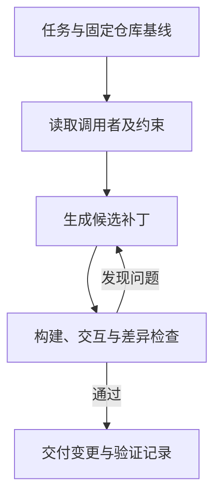

## 仓库里的事实需要独立核查

设维护任务为修复文章列表的空状态。Agent 先读取仓库规则，定位数据来源、模板与已有验证。接着修改最少必要文件，运行正常入口并检查 diff，最后形成带证据的候选补丁。构建完成、测试通过和实际发布使用不同验收记录。

## 工具、权限和审查的角色

阅读源码有助于建立理解，终端调用与编辑属于受约束操作。依赖安装、网络访问、仓库发布应各自按权限决定。审查者对照原始需求与实际修改，关注没触达正常入口、已有行为回归以及不必要的文件变动。长任务可将进度记录与代码制品一起保存。调用记录只选择有助复盘的信息。

## 看待当前证据

软件工程评测可用固定仓库任务、复现环境和自动验证比较候选系统。业务采用时补测项目特有任务、UI 或跨系统验收、错误恢复与给审查者节省的时间。评测名称、任务数据、依赖和结果条件应一起留存，便于理解指标的适用范围。

## 小结

编码能力只有落在真实项目入口、有限变更与独立验证上才具有交付价值。保留任务事实和可查补丁有助于跨运行恢复。

## 参考资料

- [SWE-bench：官方项目](https://www.swebench.com/)
- [Anthropic：Effective harnesses for long-running agents](https://www.anthropic.com/engineering/effective-harnesses-for-long-running-agents)
