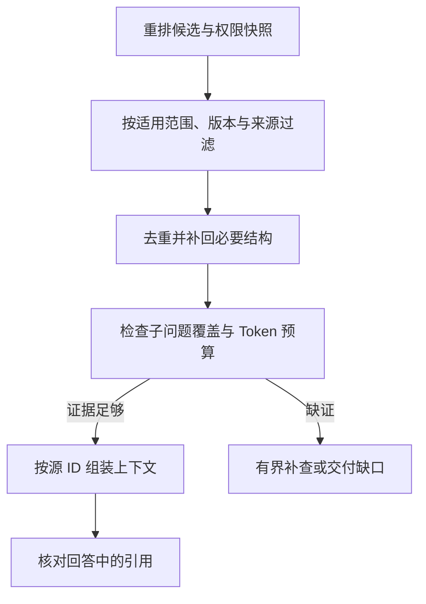

## 已经排到第一的证据，怎样才能真的进入回答

员工问「固定资产调拨超过 5 万元谁复核？合作单位是否适用？」召回有通用政策、旧版、同一段的多个重叠片段和一条较低分的例外。排序器按相关性打分，组装器必须在一个有限窗口里覆盖「谁复核」和「合作单位」两部分，使用当前权限和生效期的规则，同时让每项结论有出处。

## 用一个小窗口演算证据选择

设实际可用窗口为 2500 Token。可信指令和工具定义占 500，用户输入及必要历史占 300，输出预留 700，格式和误差预留 100。证据预算还剩 900。对不同模型使用实际分词器估计，保证平台的输入与输出限制同时满足。

| 候选 | 证据用途 | Token 数 | 处理 |
| --- | --- | ---: | --- |
| P4 | 现行调拨金额线和复核人 | 360 | 保留原文及条款 ID |
| P4a | 与 P4 高度重叠的相邻窗口 | 320 | 按原文坐标去重 |
| P4-old | 旧版采用不同金额线 | 280 | 本次查询只看现行规则，按版本过滤 |
| P9 | 合作单位例外，需要带表头理解 | 290 | 保留 |
| P9 表头 | 解释主体与地区字段 | 120 | 回读有权限的父表 |
| P12 | 相关 FAQ，没有新增条件 | 300 | 剩余预算 130，留给必要证据 |

最终证据占 770 Token，剩余 130。同一文档不同片段可能互补，应按来源坐标对重叠片段去重。如果 P9 其实没有权限，组装时标记「合作单位条件缺证」，继续查有权证据或交付部分结果。不能把空白用相似 FAQ 填过。

## 让压缩、来源和排障共用同一批证据 ID

每段证据携带文档版本、页码或标题路径、原文坐标和 ID。向模型提供的派生文本可以是提取出的句子或摘要。摘要有机会丢失否定词、例外和数值，要用原文验证关键条件，并把引用指回原记录。将用户问题、可信指令、历史和外部证据作为不同类别传入，外部证据只提供信息，不能获得新的动作权限。

评估排障至少对照四份集合：召回候选、重排候选、最终送给模型的证据和模型引用。若 P9 在第二份却不在第三份，检查去重、授权或容量。如果第三份已包含 P9 及表头而未引用，检查生成的证据使用。与纯排名优化相比，组装还应测每个子结论的证据覆盖、实际证据长度和额外回读耗时。

## 小结

上下文组装把相关候选变成有出处的任务证据。按子问题保覆盖，从原文保留必要条件，检查时间和权限，再分配窗口空间。证据不足时让系统明确降级。

## 参考资料

- [Liu 等：Lost in the Middle](https://arxiv.org/abs/2307.03172)
- [Anthropic：Introducing Contextual Retrieval](https://www.anthropic.com/news/contextual-retrieval)
