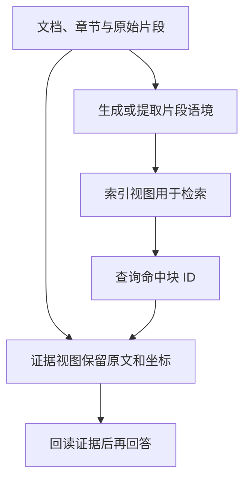

## 搜到了「下降 12%」，却不知道谁在下降

一篇季度运营报告用独立标题写着「华南仓储，2025 年第四季度」，下面的一段只说「空载率下降 12%，与上季相比」。把正文切成短块后，单块里没有区域、业务和时间。向量和倒排索引都只读到一串泛化措辞，用户按区域和季度提问就可能找不到这段。这个问题可以通过固定标题路径改善，也可以用每一块相对全文的简短说明补足。

**Contextual Retrieval** 的一种实现是在入库前训练或调用模型，基于文档与当前 chunk 生成一段有指代信息的说明，并把说明拼到 chunk 的可检索文本，用于算 embedding，也可送给 BM25。说明的作用是给搜索器提供可匹配的上下文。原片段仍是引用对应的证据，尤其要区分说明里的补全与原文直接陈述。

## 两条文本流，一套可回查的 ID

用同一个块 ID 保存原文、源坐标、标题、说明、版本与输入来源。**索引视图**可以是「2025 年第四季度华南仓储报告，比较空载率和上季｜空载率下降 12%」。**证据视图**则返回原段、章节和必要的父块来源。这样既可能通过「华南仓储」搜到段落，又可以从原报告查到那个 12% 说的是什么。不确定或有冲突的说明应留空或降级。说明来自模型时，不应让它发明区域、数值、单位或因果，生成后可检查关键实体与日期是否出现在输入。

文档超长时，逐块拿整篇进行推断需要控制成本。可用标题、文档摘要、父段及有限邻段作为输入。另外要记录上下文生成器的版本、模板和文档版本。当报告调整章节或更新年份时，受影响块要重新生成说明并替换索引，否则旧名称继续命中会造成错误。上下文生成必须受同样的文档边界约束，不能把其他租户的摘要附到该片段。

## 与父子分块、查询改写的区别

父子分块从短块命中后找回更长父段，主要解决后续模型读到的信息不足。若短块无实体而始终搜不到，父块回填不会发生。上下文增强索引提前给短块附加必要语境，直接改变召回。查询改写处理请求侧表达，无法让没有地名的段落突然携带该地名。两端都缺信息时，先用结构化字段改善入库，再测试查询侧。是否同时使用取决于不同环节的失败证据。

## 建议如何评估

设置三组：索引只用原文、原文加标题路径、原文加短说明。其他变量固定。分别测文档级与精确块级召回，检查数字、季度、实体信息和短块是否改善。看摘要诱导的误召回，例如整体文档提到北京但当前段描述深圳，说明若简单重复全篇主题就会误导排序。检查索引量、增量更新和生成成本，并测重排、最终引用支持率。共享语料且结构清晰时，标题路径往往已经是有能力的基线。

## 小结

Contextual Retrieval 在离线入库时补足片段的上下文，帮助搜索命中。它需要可逆的出处和独立证据视图，才能做到扩大搜索线索的同时保留引用准确性。

## 参考资料

- [Anthropic：Introducing Contextual Retrieval](https://www.anthropic.com/news/contextual-retrieval)
- [Dense Passage Retrieval](https://arxiv.org/abs/2004.04906)
