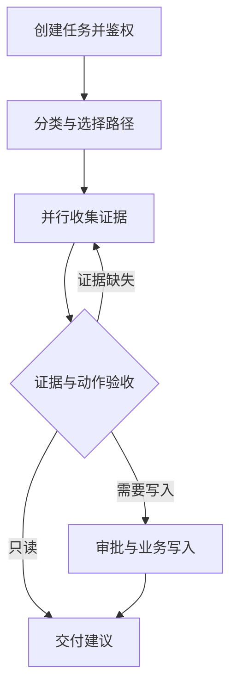

## 「查、判断、答」三格图为什么不够

设计一个工单分类与建议系统时，图上可以画模型、工具和数据库。但审查者仍需要知道：谁选择调用资料库，工具返回后谁决定是否把建议变成工单，外部执行已经成功但进程退出时谁能恢复。架构图如果只列组件，无法回答这些问题。控制流描述**谁决定哪个步骤在何种条件下发生**，数据流描述**哪些信息以什么形态被谁使用**。

## 同一个任务的两幅图

上图是控制流。运行时决定可执行动作和权限。模型或路由节点可提出决策，校验后才能进入工具节点。工具回复被提交为状态事件。证据不足可循环，写工单有审批分支，拒绝后继续交付只读建议或停止。

数据流则可以按对象表达：

| 数据 | 权威来源 | 下游如何使用 |
| --- | --- | --- |
| 请求身份和动作范围 | 鉴权和业务策略 | 运行时限定可见工具和材料 |
| 问题、候选分类 | 用户与模型输出 | 路由与任务状态，候选需验收 |
| 资料和证据坐标 | 检索服务 | 用于生成建议与人工核对 |
| 业务回执 | 工单系统 | 判定是否真实创建、用于幂等恢复 |
| 任务状态与事件序号 | 运行时的持久化层 | 确认下一步和并发更新条件 |

例如模型给出「应升级」是建议，工单状态只有业务系统能写。证据和策略可出现在模型输入，不能由模型改写成授权。用不同类型区分候选、观察、已验证事实和业务回执，能让系统错误更早暴露。

## Runtime、Orchestrator 与并行边界

编排描述节点、条件边、合流及等待。Runtime 会加载任务状态，执行节点，应用策略，管理时间和失败，并负责保存转移。有条件的实现可能将两者放在同一进程。并行读取时，三个节点可以无依赖查取消、收费与物流政策，后续合流按证据 ID 合并。若两个并行节点都更新「当前工单状态」，应避免直接覆盖。可以设计单写者、分别写各自字段，或定义幂等且可组合的 reducer。并行工作在某种环境中耗时和顺序可变，结果验收不应依赖谁先完成。

## 怎样从故障反推架构

若任务经历进程重启，恢复应从已经提交的状态开始，外部副作用按回执或幂等契约核对。若资料库只返回一半数据，组件协议应让上层看到未完成与失败原因。若用户更改请求，重新确认不可复用的状态，避免沿用过期授权和结论。架构评审可把每个外部边列出身份、输入、超时、返回类型、并发语义和所有者。先用固定工作流让结构透明，再选择确有价值的自治节点。

## 用状态版本区分业务成功和流程完成

设任务 `S-21` 当前版本为 v6，三个检索分支已提交全部证据，审批也已完成。下一步是创建工单。编排器先持久化 `operation_id=O-8`、批准对应的参数摘要、资源范围和 `submitting` 状态。工具基于该操作标识调用业务 API。工单服务成功写入并返回编号 T-84。如果返回途中进程退出，任务记录仍停在 `submitting`。恢复时由工具 Adapter 查 O-8 的业务回执，编排器再将 v6 从 `submitting` 转到 `completed`。仅凭本地状态无法区分提交成功和未执行。

| 模块 | 可以写入 | 到达失败边界如何反馈 |
| --- | --- | --- |
| Orchestrator | 任务状态、期望版本和下一节点 | 拒绝非法转移，旧事件不推进新任务 |
| Model Adapter | 候选动作、模型版本和调用 ID | 返回拒绝、格式错误或超时，保留可判定状态 |
| Tool Adapter | 调用 attempt、外部回执或待核对状态 | 区分明确失败与执行结果未知 |
| 业务服务 | 工单事实和业务操作回执 | 使用提交前置条件与可信的版本或查询结果 |

若此时另一工作进程已将任务更改为 v7，v6 的迟到工具回执仍可能表示真实业务写入。保留回执供审计和补偿判断，切勿用它覆盖 v7 的任务状态。把业务操作 ID 与运行版本一起记录，并让任务级状态转移比较预期版本。这样可以同时保留「发生了什么」与「当前运行是否还接受该结果」。

## 小结

控制流和数据流可以经过相同组件，却回答不同问题。架构应明确每步触发条件、数据权威、转移时机和恢复语义，让自动化行为能够核对。

## 参考资料

- [Anthropic：Building effective agents](https://www.anthropic.com/research/building-effective-agents)
- [LangGraph 官方文档：Graph API](https://docs.langchain.com/oss/python/langgraph/graph-api)
