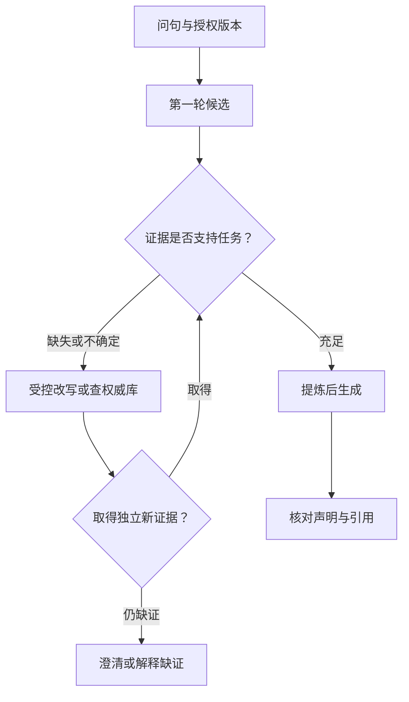

## 如果检索排名第一的材料恰好过期

系统问「目前各部门能否直接采购安全设备？」第一轮搜索找到老制度，主题和措辞都十分接近。传统链路中生成器会尽力使用现有材料，结果可能相当流畅。处理这种问题需要对「是否检索」「检索有没有得到可用证据」「生成是否被证据支持」做明确决策。两个经典研究分别展示了内部的自反思生成与外部的检索纠正。它们不等于同一种方法，也不是所有 RAG 的固定步骤。

## Self-RAG 怎样将反思变成生成控制

Self-RAG 训练生成模型输出特定反思标记。其方法利用训练时构建的监督，让模型决定是否检索，并对文档相关性、生成内容是否受支持、内容是否有用做判断。推理按片段组织，候选可以通过标记对应的分数参与选择。这里反思信号来自模型训练与解码过程。把一句「请反思」加进任意普通模型提示可以是工程近似，但并不会得到论文中的控制标记、训练方式或同样效果。

可能的失败是模型与判断共享同一种偏差。模型擅长识别主题相同，却可能在相关性高的过期材料上作出支持性判断。业务上的生效时间和授权状态应先由应用约束。高影响结论仍需把证据和版本保存到轨迹，由外部规则、评估器或人工核对。

## CRAG 如何用独立评价触发后续动作

Corrective RAG 论文在检索之后加入轻量评价器，判断已检索文档的整体质量，并采用不同动作。高质量材料进行知识提炼后加入生成。低质量或不确定时可拓宽检索或结合外部信息，其公开实验中包含 Web 搜索。实际企业系统使用哪些库、是否可以访问外部、用原语料中的哪种版本，需要显式授权。外部搜到同名制度也不能当作公司的有效政策。更贴近企业场景的替代动作是检查当前版本、改检权威库、请求澄清或给出缺证说明。

## 把纠错门控设计成可以验证的机制

为常见异常设可区分状态。**无候选**可尝试改写或词法补召回。**相似但范围错误**先修正时间和实体过滤。**正反证据冲突**查发布时间、适用主体与条款优先级，仍冲突则保留分歧。**答复声称证据中没有的事实**交给生成或引用验收层处理，继续扩大搜索有时只会引入噪声。阈值从标记了可答、无答案、有冲突与权限失败的样本估计，并分别追踪漏纠错率、错误放行和多余重试。

固定工作流可以预定义一轮纠正；[Agentic RAG](/agent-engineering/rag/agentic-rag/) 则根据本次的具体证据缺口选择下一行动。二者都可以使用外置评价器。一次纠错无新增来源时减少预算，记录最早出现偏差的位置，避免系统把两个相似旧段互相评为正确。

## 小结

Self-RAG 通过训练得到的反思标记控制检索和生成。CRAG 使用外部检索评价来分流。实际落地要把相关性、证据支持和业务有效性分别确认，并在预算耗尽时给出缺证或冲突说明。

## 参考资料

- [Asai 等：Self-RAG](https://arxiv.org/abs/2310.11511)
- [Yan 等：Corrective Retrieval Augmented Generation](https://arxiv.org/abs/2401.15884)
