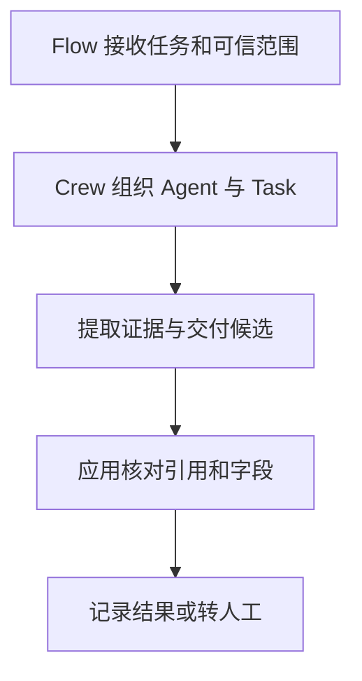

## 用 Task 写清楚角色要交付什么

合同核查需要阅读附件、提取版本与日期、生成比较表。CrewAI 中的 Agent 定义角色、目标和可用工具，Task 定义要做什么及期望输出，Crew 组织成员和任务。实践中应把「负责审查」展开成明确输入和产物，把条款 ID、当前生效日和证据字段纳入验收，而不仅用自然语言的角色描述。

## Process 控制 Crew 内部怎样工作

顺序 Process 适合已知「抽取、复核、整理」顺序，各任务可以接收前序产物。分层 Process 引入管理者选择工作者并核对输出。可按实际版本配置管理 Agent 或管理模型。地区知情任务存在不同工具或资料时，分层可能有价值。若核查步骤稳定，管理者重复生成计划会增加时间和费用。

| 信息 | 放在哪 | 为什么 |
| --- | --- | --- |
| 角色擅长的内容 | Agent | 制定工具与职责范围 |
| 交付格式和验收材料 | Task | 能验证每个分支的实物结果 |
| 管理或顺序的规则 | Process | 确定 Crew 内部控制权 |
| 授权、事件路由和持久状态 | 外层应用或 Flow | 决定跨团队业务流程及结束条件 |

## 什么时候需要 Flow 包围 Crew

如果资料扫描失败，应用应先控制是否补件或进入人工分支。Flow 将这些事件和状态组织为明确步骤，Crew 则在其中承担语义工作。回归时分别检查 Crew 的产物契约和 Flow 的失败转移。对于外部修改，继续使用稳定操作身份和真实回执。代码升级时检查 Process、Flow 持久化和恢复 API 的具体版本，保持业务验收固定。

## 小结

CrewAI 为角色和任务提供协作模型。用显式 Flow 管状态与关键分支，把 Crew 的自由度限制在真正需要的环节。

## 参考资料

- [CrewAI：Processes](https://docs.crewai.com/en/concepts/processes)
- [CrewAI：Flows](https://docs.crewai.com/en/concepts/flows)
