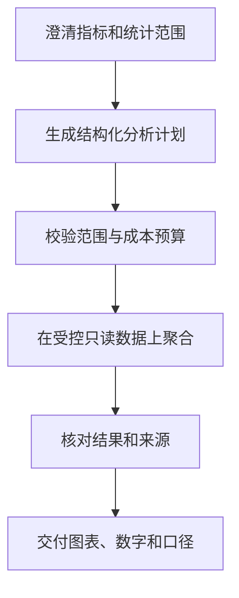

## 先规定什么算解决率

虚构工单数据库中，团队问「上月各区域解决率是多少」。要澄清按上月创建的工单作为分母，按本次统计截止已解决的同批工单作为分子，并确认地区、时区和状态定义。模型负责识别语义与提出分析计划，受控查询器对照指标目录解释字段、范围和合法操作。

## 怎样限制执行与核对结果

用允许的视图和预定义指标定义组织查询，可信身份与租户由服务注入。数据库使用最小权限只读角色，限制执行时间及结果行数。记录所选指标版本、起止区间、快照和字段。报告不应默认返回明细身份数据。更新或管理操作由另外有明确授权的流程处理。

假设地区 A 创建 100 单、解决 90，B 创建 10 单、解决 3，地区 C 暂无样本。有数据区域整体解决率为 93/110，约 84.5%。90% 与 30% 的简单平均为 60%，对应的是地区等权指标。地区 C 标为无样本，不当作零。用例还要覆盖状态变更晚到与日期跨时区。

## 让结果可以被独立复算

输出同时包含报告和结构化制品，标记数据快照、口径、各组分子分母和例外。校验行数、范围及区间边界。若资源预算不够，用预聚合视图或转后台作业，再按同一口径验收。生产时用重复运行检验指标稳定性，遇到未知字段转成澄清而非生成替代值。

## 小结

先解释指标，再提议查询与图表。用权限、成本边界和可复算制品把自然语言需求变成可靠分析。

## 参考资料

- [PostgreSQL：Privileges](https://www.postgresql.org/docs/current/ddl-priv.html)
- [PostgreSQL：Aggregate Functions](https://www.postgresql.org/docs/current/functions-aggregate.html)
