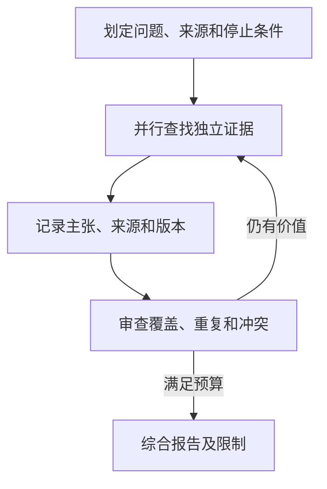

## 长报告怎样把检索变成证据生产

Deep Research 常包含多步公开资料检索、分解子问题、回顾查证和综合报告。普通问答通常围绕一次上下文组装，长程研究则要维护目标、来源账本、代理分工和未解决问题，并可以在新证据改变前提时重排计划。

## 从一个证据错误推到系统设计

研究三个产品的功能。一份文档来自 Beta 发布，另一份是旧版价格说明。若合流只看片段相似度，可能把功能、版本、价格拼成不存在的组合。给每条主张保存产品、版本、观测日、支持段落及反证。跨分支比较时先对齐对象和时间，对无权访问或不可复核资料另行标记。研究报告引用的可靠性可按抽样主张逐条核对。

## 能力现状与评估

公开产品已经能展示多步浏览与报告生成。面向特定业务的资料完整性、时效与引用支持仍要验证。对照相同问题的单轮 RAG、有限多步检索与并行研究，记录每个子问题覆盖、引用定位准确率、新增资料贡献和单位成本。将搜索失败、上下文遗漏与综合错误分开归因。

## 小结

Deep Research 将搜索、证据账本和综合组织成长程任务。质量来自可核对的主张、明确限制和来源对照。

## 参考资料

- [OpenAI：Introducing deep research](https://openai.com/index/introducing-deep-research/)
- [Anthropic：How we built our multi-agent research system](https://www.anthropic.com/engineering/multi-agent-research-system)
