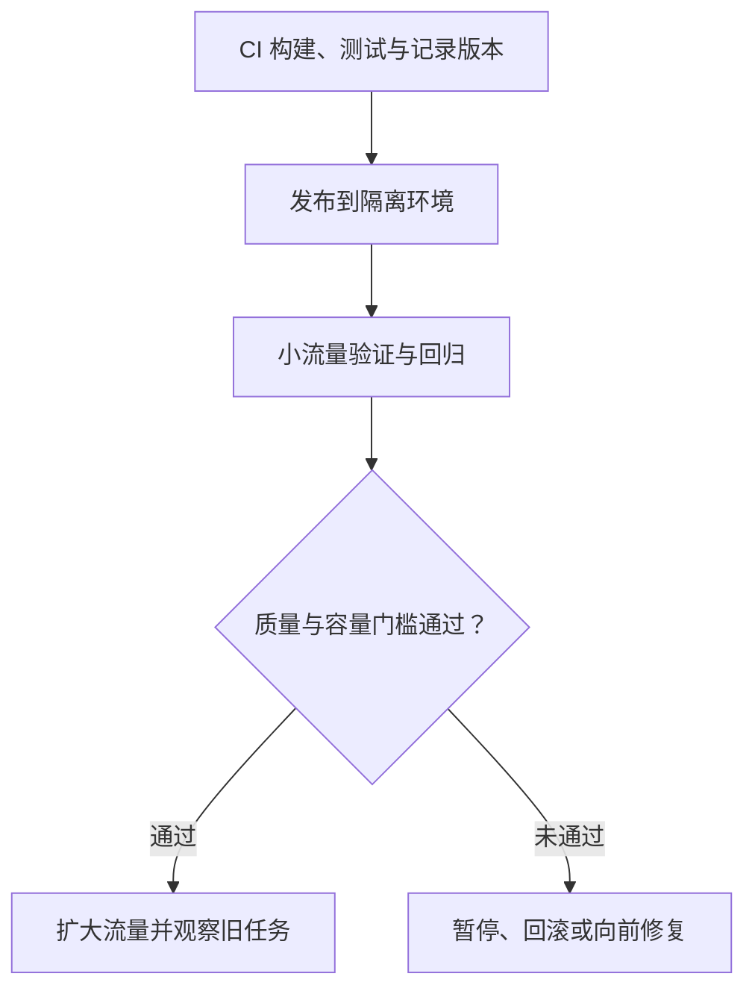

## 发布的是一组可追踪的运行版本

政策核查应用从测试切到线上，变化可能包括 OCI/Docker 镜像、状态结构、提示词、工具参数、模型服务和向量索引。构建流水线执行锁定依赖和测试，再生成可标识的镜像。环境映射区分数据库、凭据、对象存储和队列。运行日志记录该任务采用的镜像、工作流、模型和索引版本，迅速识别哪种组合出现问题。

## 容器滚动更新时怎样处理长任务

使用独立的 API、Worker 和推理服务时，各自测连接、任务堆积和模型吞吐。Kubernetes Deployment 的 rollout 控制 Pod 版本和可用性。对 Worker 的关闭处理，停止新领取，给进行中的任务有限收尾时间。未完成工作留在持久状态与队列，用已验证的版本恢复。readiness 控制就绪流量，进程重启条件由 liveness 等信号表达。初期可用启动探针保护需要较久初始化的容器。若使用长连接，主动验证负载均衡、连接断开与事件重放。

## 为回滚保留可读的版本组合

从状态 v1 增加一个必填字段时，可以先引入兼容读取，并让新字段可由旧数据推导或补齐，在旧 Worker 清空后再收敛 Schema。若直接删除旧字段，旧镜像就可能读不回现有长任务。新索引和查询向量必须匹配，回退同样需要切回相应配置。模型服务如果独立部署，先用相同任务验证路由与证据指标。

灰度把新请求分配给小流量群组，并保留可比较的基线。对比结果须同时看可靠性、否决与授权路径，以及真实业务回执。出现「平均成功率相同但关键组退化」时，暂停放量。回滚后验证计划继续、旧任务可读、事件可回放和索引引用可打开。对已发生业务写入，回滚应用无法撤回业务状态，需要另外依据操作回执处置。

## 小结

用 CI 记录版本和证据，按流量与长任务兼容性决定切换。回滚要同时检查状态、依赖与已有副作用。

## 参考资料

- [Docker：Building best practices](https://docs.docker.com/build/building/best-practices/)
- [Kubernetes：Deployments](https://kubernetes.io/docs/concepts/workloads/controllers/deployment/)
- [Kubernetes：Liveness、Readiness 与 Startup Probes](https://kubernetes.io/docs/concepts/configuration/liveness-readiness-startup-probes/)
