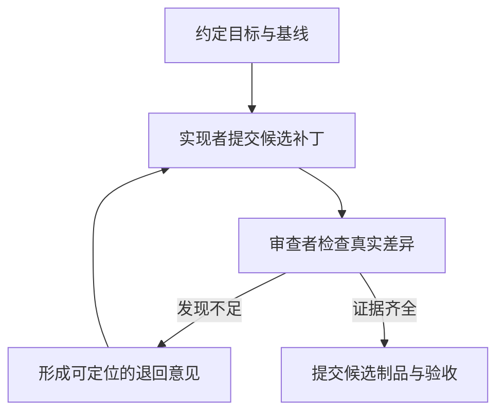

## 一个小功能如何划分责任

虚构项目要给文档页增加标题筛选。产品要求键盘可用、现有路由不变，并保留空结果提示。Supervisor 持有需求和任务状态，计划者草拟验证条件，实现者在隔离工作区改动，审查者读取真实 diff、测试及页面证据。合并由项目授权者决定。

## 交接的对象是证据

计划阶段保存原规则、边界和样本。实现阶段交接文件、变更与仓库基线版本。审查者用一份固定样本核对标题命中、空状态、窄屏与键盘行为，并确认索引输出不影响其他栏目。若需求修改为跨正文全文搜索，Supervisor 应更新任务版本，按变动范围重排。旧的标题测试成果可以保留，整体完成状态必须重新确认。

## 评估团队是否值得使用

在相同的三个小任务上比较单 Agent 和团队方式。以验收通过率、返工次数、耗时和无需修改文件的变更率为指标。若单步修订主要浪费在重复总结和同步，可将审查改成实际工具核查并减少角色。对跨组件工作，再使用并行分支和独立审查。高层协调角色只处理依赖与证据，避免每位成员携带全部上下文。

## 小结

多角色开发的增益来自可独立验证的制品和责任分配。用明确任务版本和最小权限让计划、实现、审查及授权发布各自可追踪。

## 参考资料

- [Anthropic：Building effective agents](https://www.anthropic.com/research/building-effective-agents)
