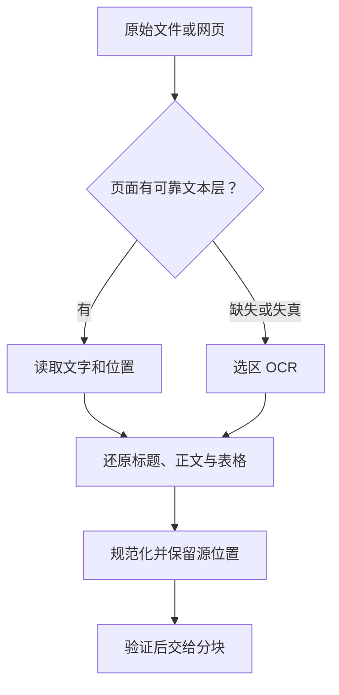

## 问题通常发生在字被识别出来之后

一份报销手册写着「市内交通」与「出差交通」两列，每列都有「工作日」和「特殊情况」。页面看上去没有歧义。直接按文本对象的存放顺序读取 PDF，却可能得到交错的两列，表格中数字失去行列标题。假如「500 元」对应哪类交通在解析时已经丢失，之后的向量检索无法从这几个字恢复正确关系。

解析的目标是得到可验证的**文档结构**，随后才交给 [Chunking](/agent-engineering/rag/chunking/) 决定检索粒度。建议统一成文档、区块、关系三层。区块可以是标题、段落、列表项、表格、图片或注释。每块保留阅读顺序和标题路径，关系显式表示表格属于哪个章节、图片对应哪个图注。

## 四种格式怎样解析

| 格式 | 优先提取 | 常见失真 |
| --- | --- | --- |
| 原生 PDF | 页面文本、字体、位置与对象信息，按栏目重建阅读顺序 | 对象顺序和页面阅读顺序不同，文字层可能重复或缺字 |
| Word | 段落、标题样式、编号、表格、脚注及文档属性 | 手工加粗未设标题样式，合并单元格和修订状态影响语义 |
| HTML | DOM、文章正文、语义标题、列表、表格、链接和页面元数据 | 导航和页脚混入正文，异步渲染内容缺失 |
| Markdown | 解析语法树，保存标题路径、围栏代码、表格及链接 | 按行正则拆分容易误认代码块里的井号、列表或管道符 |

扫描 PDF 或图片使用 OCR，把文字框位置与置信度一起带出。混合 PDF 应逐页或逐区判断。整份统一执行 OCR 会把已经正确的文本层重新识别，也可能产生重复字。对低置信度的金额、编号和日期，保留原页供人工核查，比悄悄修正更可靠。两栏文件通常先找栏区域，再在栏内按行串起块，脚注则以独立区块挂回锚点。没有明确阅读顺序时，保留列或网格上的邻接关系和解析置信度。

## 表格和图表需要另外处理

表格需要同时保留单元格的行列坐标、跨行跨列、分组表头、单位和适用条件。一条可检索的证据可以是「城市级别＝一类｜工作日上限＝500｜单位＝元／天」，同时保留原表的位置。跨页表若表头未重现，要继承前一页的表头并保存两页的来源。图表先提取图题、图例和轴单位，能拿到附属明细表时优先以它为数值依据。仅有图片时，可提取可见文本和概括，不能把模糊的视觉估读当作精确数值。

这里的**出处**至少由文档 ID、版本、源地址、页码或结构定位组成。针对清洗文本，再保存能映射回源块的坐标。例如归一化全角字符后，清洗文本的第 50 个字符未必还是原文本的第 50 个字符。存原坐标或变换映射，后续高亮引用才准确。

### 双栏和跨页表格怎样恢复成可引用记录

假设第 3 页宽 600 PDF 点。左栏文本框大多落在 x=50–270，右栏落在 x=320–550，横贯两栏的标题框落在 x=50–550。若直接按全页 y 坐标从上到下排序，左栏第一行后可能紧接右栏第一行。先识别跨栏标题为布局分隔符，再在标题下把盒子按栏聚类并各自按 y 排序。脚注和页眉使用独立类型，避免编进正文段落。坐标需注明原点、旋转和单位，扫描页上应保存 OCR 像素与 PDF 页面坐标的换算。

第 4 页表格的首行是「地区｜工作日（元/天）｜节假日（元/天）」，第 5 页只剩「上海｜500｜650」。若前页表格延伸到页底、列边界与下一页一致，并有连续版式信号，可以为第 5 页记录关联前页表头。具体测试要同时核对上海这一整行以及工作日单元格的原坐标。另一张同宽度但表头不同的相邻表是必要的反例。跨页信号不足时保存待确认关系，避免按表宽把两张表误接起来。

## 清洗与变更如何落地

先移除重复页眉、空白和明显的模板导航。不要在规范化时擅自丢弃单位、减号、脚注号或政策生效日。解析结果先做有代表性的抽查，覆盖双栏、有表格、带扫描页和修订痕迹的文件。每次改解析器，固定源样本检查行序、数字、页号及可检索证据，模型的最终回答只能作为补充。

文档更新时应有稳定的源 ID 和独立版本，解析器自身也应该有版本。新索引只有经过校验才切换为活动版本。同一文件增量更新时，旧的证据 ID 可归档，撤权时必须同时清除搜索、预览与缓存的旧传播路径。否则正文链接可能还在，当前权限却已经变化。

## 小结

解析输出应完整表达「写了什么、出现在何处、属于哪个上下文、谁可以读」。这四类信息支撑后续分块、过滤、检索和引用。

## 参考资料

- [pypdf 文档：Extract text from a PDF](https://pypdf.readthedocs.io/en/stable/user/extract-text.html)
- [CommonMark 规范](https://spec.commonmark.org/)
- [Microsoft：WordprocessingML 文档结构](https://learn.microsoft.com/en-us/office/open-xml/word/structure-of-a-wordprocessingml-document)
