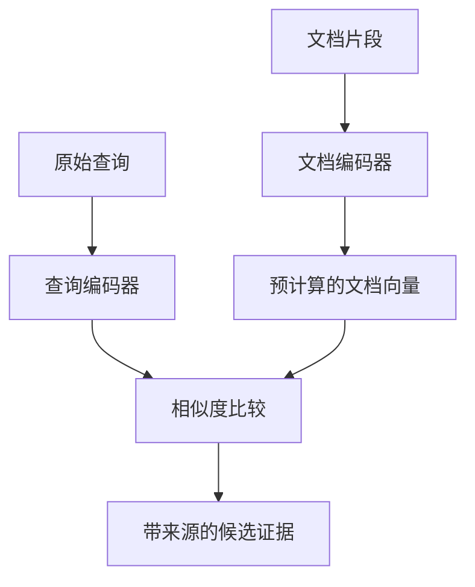

## 关键词不同，表达的意思可能一样

用户输入「设备在两个部门之间转走，需要谁签字」，政策文档用的是「跨部门固定资产调拨审批」。两个文本可能缺少明显的词重叠，却描述相近的业务语义。Embedding 把查询或证据片段转换为固定维数的向量，使相近关系可以用几何分数近似表示。检索侧的句段向量与生成模型里逐 Token 的嵌入层是两个用途，后者未经专门训练便做池化，并不保证能很好地给查询和文档排序。

## 双塔与训练目标

稠密检索常使用双塔结构。查询编码器把用户问题编码为 q，文档编码器把每个块编码为 d。两塔参数可以独立或共享，部署时还可能分别用 query 和 passage 的前缀。关键在于分开计算，文档向量能预先离线算好。在线只需要编码一次查询，再用索引比较候选。

训练时为问题配一个或多个正例和负例，模型要给正例更高的相似分。常见的对比损失为负对数的正例 softmax 概率，分母包含正例和负例。主题相同、答案不同的难负例尤其重要。例如「在固定资产上做维修」与「转移固定资产」词汇近似，只有后者能回答转移审批问题。训练里也可能含假负例，同一政策的另一段有效表述被当作无关样本，这会损伤模型对等价证据的识别。

## Cosine、Dot Product 和距离

对于非零 q、d，点积是各维乘积之和，余弦是点积除以两个向量的模长。点积既看方向也受向量长度影响。两边都单位化时，点积等于余弦，欧氏距离平方等于 2−2×余弦，因此这三种排序等价。单位化有时会破坏模型有意利用的向量模长信息，应遵循训练与部署约定。

向量 q=(1,0)，候选 A=(2,2)、B=(1,0)。点积对 A 打 2、对 B 打 1，选 A。余弦对 A 打约 0.707、对 B 打 1，选 B。由此可见，除了模型名称，还要把度量、前缀、输入截断、维数和归一化方式视为索引契约。更换其一时要重建或并行构建新索引，不能直接比较不兼容的向量。

## 选型要对着错误挑

公开排名提供粗筛，最终样本应覆盖中文口语、专业术语、跨语言、产品编号、否定、日期与数字。在混合语言资料上，要分别测「同语言检索」和「跨语言检索」。截断常从长段尾部漏掉例外，中文的 Token 分布也与英文不同，测试要用实际编码器。先对小样本做精确检索，比较模型和分块，再固定模型测试 [ANN](/agent-engineering/rag/vector-indexes/)。同时记录文档重编码成本、向量体积、请求延迟和授权过滤后的候选覆盖。

编号、罕见名称和精确金额容易需要 [Sparse Retrieval](/agent-engineering/rag/sparse-retrieval/) 补充。向量相似也不会自动验证逻辑方向。「需要审批」与「无需审批」可能在空间里很接近，后面的重排、版本核对与证据验收承担这部分职责。Embedding 分数只用于排序时，也不宜直接跨模型或跨语言用一个固定阈值充当答复置信度。

## 小结

Embedding 是可训练的相似度表示。用一致的索引契约保持可比较性，再用真实难例检查语义召回，以及词法、时间和适用性信号的补充价值。

## 参考资料

- [Dense Passage Retrieval 论文](https://arxiv.org/abs/2004.04906)
- [Text Embeddings by Weakly-Supervised Contrastive Pre-training（E5）](https://arxiv.org/abs/2212.03533)
- [MTEB: Massive Text Embedding Benchmark](https://arxiv.org/abs/2210.07316)
