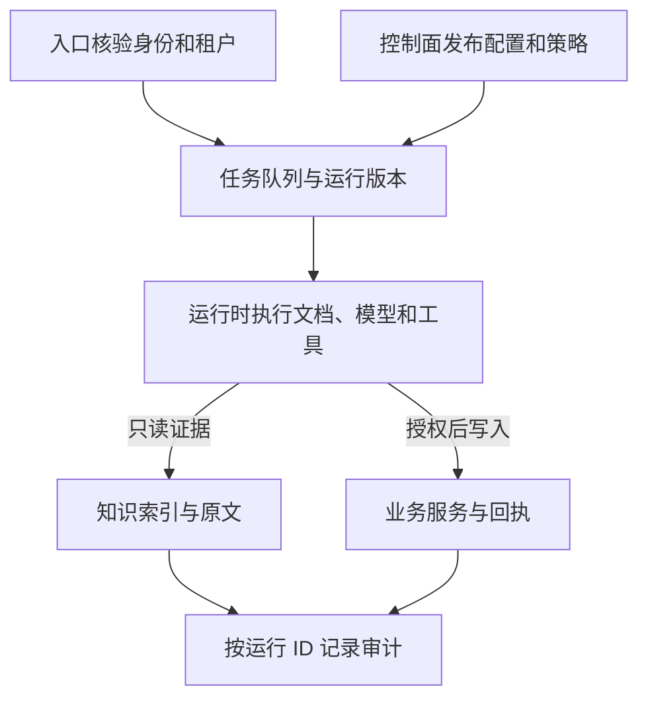

## 一条企业请求穿过哪些边界

公司希望客服知识助手为不同客户组织引用内部手册，在授权时创建工单。API 接入验证用户与租户。任务服务创建运行记录并分配版本。检索服务按租户、角色和生效日期选证据。模型整理建议。工单工具把租户身份和允许的动作交给权威业务服务校验。一旦写入结果未知，任务进入待核对状态并保留业务操作标识。

## 把治理和业务事实分别交给合适的系统

| 对象 | 权威服务 | 关键约束 |
| --- | --- | --- |
| Agent 配置、工具注册和版本 | 控制面配置仓库 | 变更审批、灰度和可回滚版本 |
| 租户身份、授权、预算 | 权限和配额服务 | 工作进程从可信任务上下文取得范围 |
| Session 与 Thread | 会话服务 | 只关联可见历史，避免用会话 ID 当凭证 |
| 任务进度与恢复 | 持久任务存储 | 用版本与事件序号检查重复和发散 |
| 知识内容与索引 | 文档服务与可授权检索 | 原文版本、索引代、撤权及引用一致 |
| 业务变化和审计 | 业务服务、独立审计存储 | 审批、操作 ID、回执、访问审计 |

例如租户甲、乙都使用工单号 C-27。若接入正确验租户，工具缓存却只按 C-27 命中，乙仍可能看到甲的历史回执。缓存和 Adapter 的资源标识应包含经过验证的租户作用域。异步 Worker 重新读取授权时，必须能追踪是谁提交任务、哪个主体有权批准、结果发布给谁。将模型看见的信息限制在该运行需要的范围内。

## 扩展与回滚从明确的故障域开始

共享数据库加租户字段，适合数据规模和合规边界相近且能验证访问隔离的场景。专用索引、计算队列或数据面适合隔离要求高、性能差异大或临时需要独立容量的租户。扩容前先确认瓶颈是工具服务、模型配额、数据库还是 Worker。对含写入的任务，记录从审批到业务回执的完整 Trace，避免仅依赖 UI 提示验收。

灰度时固定运行级配置版本，使旧任务可恢复并可解释。上线验证同时覆盖租户甲乙同名资源、撤权后恢复、单租户限流和写成功后 Worker 退出。回滚要确认兼容旧任务数据和现行权限。关键证据保留版本和最少必要字段，正文与敏感参数按授权访问，审计日志避免复制整段输入。

## 小结

企业架构的关键边界是主体、权限、资源、运行版本和业务回执。把控制治理、实际执行、知识和审计分别建模，再选相应的部署方式。

## 参考资料

- [NIST：Zero Trust Architecture，SP 800-207](https://csrc.nist.gov/publications/detail/sp/800-207/final)
- [OpenTelemetry：Traces](https://opentelemetry.io/docs/concepts/signals/traces/)
