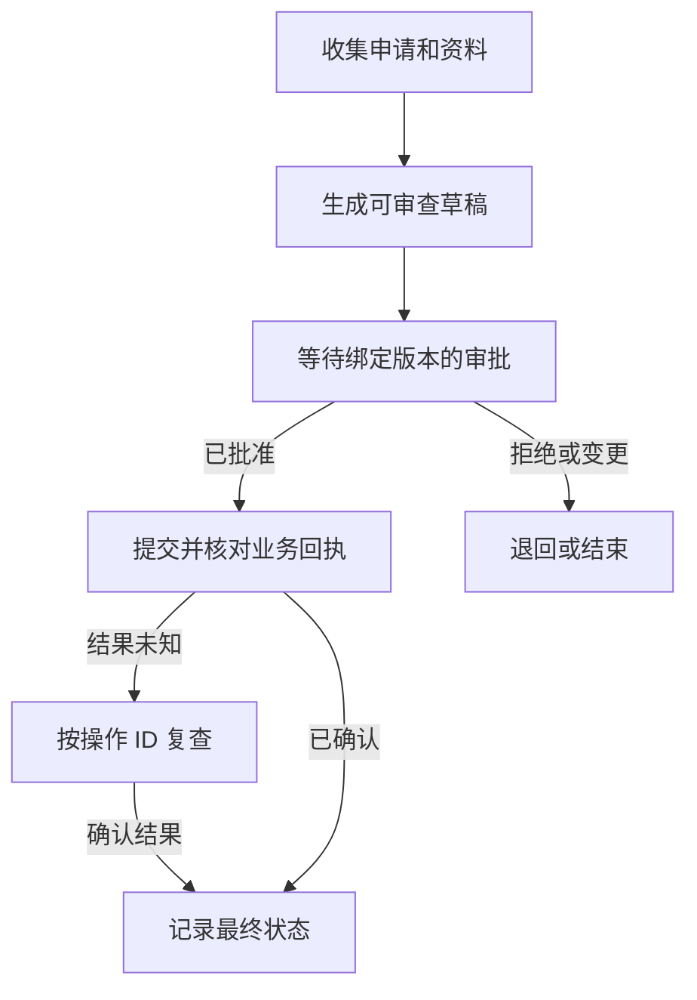

## 先找到具有副作用的分界

内部采购任务从材料归集、预算核对、草稿准备、授权审批走到业务提交。文档、候选制品与审批分别有版本。模型可以在准备阶段查找材料并提出草案；提交必须走确定性工作流，受预算、授权和目标对象状态约束。

## 一次暂停恢复怎样避免重复采购

审批关联草稿 v4 和 10000 元申请。用户改成 12000 元后，产生 v5，旧审批不生效。批准 v5 后，Worker 记录稳定操作 ID 并调用业务系统。若外部成功但返回超时，先查询该操作，再更新任务。相同逻辑操作只保留一个真实结果，不因重投另起身份。若操作失败且当前业务允许补偿，另外建立带授权的补偿任务。

## 从小范围开始部署

先只生成草稿和理由，人工在业务系统操作。回放批准及提交验证有把握后，再对部分团队开启受控写入。门槛包括批准参数与实参一致、重复消息下实际只有一个对象、拒绝和撤权时确无副作用。把权限、证据、阶段和结果写入可追踪记录。业务回执系统独立于聊天和模型状态。

## 小结

企业自动化应在实际副作用前确认业务契约，审批与状态可恢复，最终结果可追踪。选择合适的模型环节能降低业务状态变更的随机风险。

## 参考资料

- [AWS：Transactional Outbox](https://docs.aws.amazon.com/prescriptive-guidance/latest/cloud-design-patterns/transactional-outbox.html)
