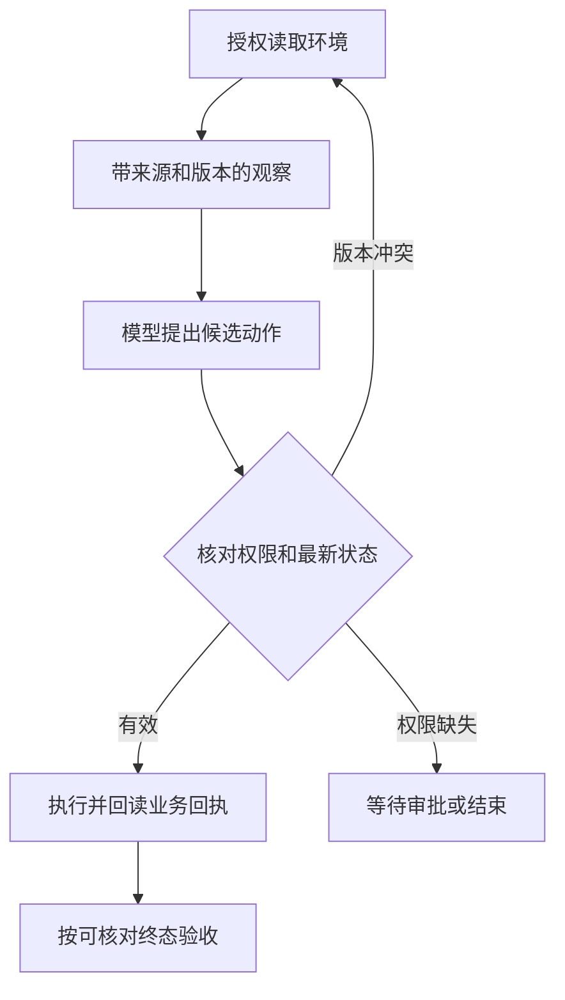

## 环境有自己的真实状态和时间

用户问「客户工单还是待处理的话，把状态改成已受理」。系统要区分三个对象：业务系统中工单的真实状态，Agent 最近取得的观察，以及本次任务计划中的状态。观察可能来自 API、浏览器可访问性树或截图。即使模型准确读到「待处理」，在它发出动作时工单仍可能已被别人关闭。理解环境需要给观察加上来源、身份、时间和版本。

## 观察和动作对不同接口有不同的保证

| 环境 | 常见观察 | 动作及其核对 |
| --- | --- | --- |
| 搜索 | 查询、摘要、返回时间和来源 URL | 搜索用于定位，核对原始来源与适用范围 |
| 浏览器 | DOM、可访问性角色、URL、视图状态 | 用稳定元素语义定位，变更后检查目标资源和业务回执 |
| 桌面 | 窗口、截图、焦点和控件可访问性 | 核对前台窗口、控件与动作后状态，避免焦点变化写错目标 |
| HTTP API | 结构化字段、版本和状态 | 使用身份与资源校验，条件写入后读明确回执 |
| 数据库 | 带事务时点的记录或只读视图 | 用约束、事务或条件更新保护一致性 |
| 文件系统 | 路径、内容、版本或哈希 | 在允许目录读写，修改后核对目标及内容差异 |

浏览器的「提交」按钮可能与备注表单和整个工单编辑都同名。稳定的角色、可访问名称及表单范围能提供更明确的定位依据。页面跳转、网络请求成功或点击完成只能说明发生了一次交互，业务操作完成需要从业务服务或下一页面状态确认。搜索结果摘要可能落后于原页面，网页内容也只是环境数据。在调用任何写工具前，宿主应根据可信任务意图和允许操作确定权限。

## 用一次更新说明观察如何失效

第一次读到工单 `T-9` 为待处理，版本 `v7`。在系统支持条件写入时，执行器要求「仅在当前版本为 v7 且状态为待处理时修改」。如果服务回报版本冲突，应重新读取状态，而不是撤销别人的更改。如果同一次操作已成功，恢复时用原操作 ID 找回回执。如果环境只有 UI 且缺少等价的并发保护，仍要做临近执行前的回读，并向用户明确确认后的操作范围。执行高影响而难以验证的动作时，可请求人工接管。

外部集成需要设置读写范围、单次及总预算、并发限额、结果体积、身份隔离和必要的网络访问。沙箱适合在隔离范围内读文件、运行处理任务或检查数据，真实写入和敏感凭据仍由宿主按任务授权。环境适配器应保留结构化回执并把错误分类传回运行时，使恢复流程能区分暂时失败、状态冲突、权限拒绝和未知结果。

## 小结

观察是带时间与来源的证据，动作是受权限与业务条件约束的请求。以可信回执和当前资源状态验收，Agent 才能区分操作已经完成、仍需核对或应由用户接管。

## 参考资料

- [IETF RFC 9110：HTTP 条件请求](https://www.rfc-editor.org/rfc/rfc9110.html#name-conditional-requests)
- [Playwright 官方文档：Locators](https://playwright.dev/docs/locators)
