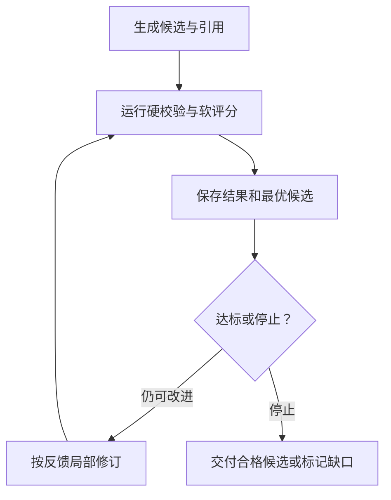

## 审查报告需要什么样的反复改进

合规报告既要可读，也必须准确引用现行条款。生成器先给候选报告。Evaluator 使用统一的规则与评分表，判定证据覆盖、引用可核查和解释层次。Optimizer 根据反馈调整候选。宿主保留候选、检测无进展，并决定何时交付。生成器可以是模板，也可以是模型。评估器由确定性检查、证据比对和生成式评价共同构成。

| 候选 | 引用授权及事实硬检查 | 可读性（满分 5） | 处理 |
| --- | --- | ---: | --- |
| A | 通过 | 3 | 保留为当前最优 |
| B | 一处引用已失效 | 5 | 不进入候选池 |
| C | 通过 | 4 | 优于 A，可以交付 |
| D | 通过 | 4 | 比较覆盖与长度，避免无上限迭代 |

设置总预算或无进展阈值。例如至多 2 次额外改写，同时要求全部硬条件通过、简洁度达到 4。将评估回执写成缺失字段、源 ID、失败条件和允许改动范围。缺证来自检索时应回到取证流程。只给「再润色」会让评价与修订脱离业务事实。

### 校准评价，与真实任务结果对齐

用独立人工样本检查评价尺度，对成对候选交换顺序以排除位置偏差。生成时保留规则、模型和数据版本。比较单次生成、一次局部反思和多轮优化的质量、尾部延迟及成本。对容易的任务提前跳过循环。若评价反复提高而人工通过率下降，先检查评分准则。需要审批的步骤仍由授权者承担，评分门槛只处理产物质量。

## 小结

用分离的生成和评分组件组织反馈循环。先过硬约束，再比软指标，保留最优合格候选并限制改进成本。

## 参考资料

- [Anthropic：Building effective agents](https://www.anthropic.com/research/building-effective-agents)
- [Zheng 等：Judging LLM-as-a-Judge](https://arxiv.org/abs/2306.05685)
