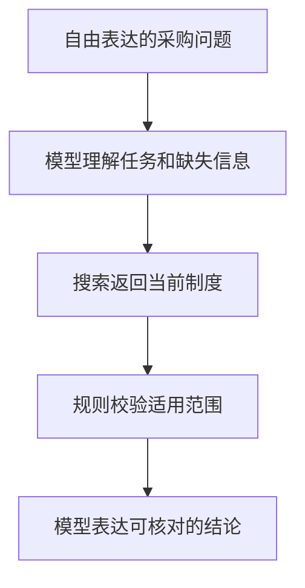

## 一项任务如何推动应用形态演变

早期报销查询可以设计成表单。员工选部门、费用等级和地区，规则系统按编码过的条件返回审批人。如果有人输入「在深圳打车去机场算差旅吗」，系统只能要求转换成已有字段。表单清楚、可验收，对输入多样性支持有限。把完全相同的请求放进企业搜索，用户能找到制度，但还得自行辨别版本、挑选条款和整合条件。

监督学习能从标注样本中学出问题分类或实体提取。例如把自由输入映射到「市内交通查询」，再抽取城市。这种系统在标签明确、例子充分时高效，新增任务通常需要新增专门模型或样本。生成式预训练模型把许多语言任务统一成在上下文中预测后续 Token，输入可以同时包含指令、示例、问题和证据。成熟的文本生成能力使应用能更灵活地解释意图、生成候选参数以及组织结果。

## 模型为什么同时能做解释、转换和分类

Token 是模型的输入和输出单位，可以是常见字、子词或符号。语言模型根据已出现的 Token 序列预测下一项分布，并把选出的 Token 接回输入继续生成。训练阶段利用大量数据中的语言规律调整参数，后续对齐可让模型更适合按指令工作。在上下文里给「输入→输出」示例时，模型可以顺着给定格式继续生成。因此翻译、归类和摘要都可以通过语言表达任务与输出。它是否做对要由任务定义和外部验证判断。

这个变化把很多「理解非结构化输入」的工作从大量固定模式移动到可重用的语言接口。过去一次改字段可能要扩展规则字典，如今可以加入语义描述和例子。但生成是概率式决策，同一数据可能产生多种措辞，输入中的噪声也可能改变回答。对需要精确计算、实时事实、访问控制和副作用的场景，可靠组件仍被保留。系统可以让模型读问题，让搜索提供制度，让规则选择生效版本，让业务服务执行审批。

## 知识、上下文和行动的边界

训练参数中的知识不是实时资料库，信息无可直接核对的来源，可能冲突或过期。上下文能把当前问题所需的事实给模型，但容量有限，位置和内容都会影响使用。模型可能输出看似符合规则的内容，却没有当前制度作为依据。用 [RAG](/agent-engineering/rag/) 将外部证据带入上下文能改善可核查性，是否具备足够证据仍需确认。

模型生成「我已经提交审批」只是文本。真实动作需要宿主授权、调用业务服务并获得回执。早期代理系统、机器人和自动规划早已研究「观察后行动」。LLM 带来的变化是把语言解释、知识组织、工具请求变成一类通用决策接口。围绕这个接口加入外部工具、任务状态和多轮反馈，才形成今天常见的 LLM Agent 应用。代价是测试范围由一次输出扩到动作、权限、恢复和验收。

## 小结

规则、搜索、专用模型和生成模型解决的问题不同，成熟系统经常组合它们。模型负责难以穷举的语言理解与候选决策，明确的业务事实和执行权由数据和程序给出。

## 参考资料

- [Vaswani 等：Attention Is All You Need](https://arxiv.org/abs/1706.03762)
- [Brown 等：Language Models are Few-Shot Learners](https://arxiv.org/abs/2005.14165)
- [Anthropic：Building effective agents](https://www.anthropic.com/research/building-effective-agents)
