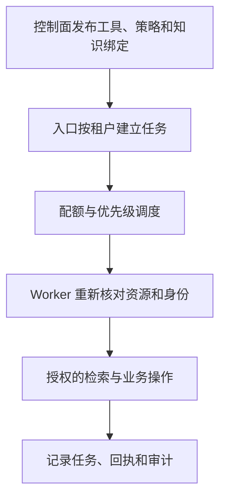

## 从两个团队共享平台说起

采购团队查询合同并在审批后提交草稿。人事团队查询政策，工具仅限只读。两者可共享模型和队列基础设施，但数据、访问授权、预算与任务交付分开。平台控制面维护 Agent 注册、发布版本、可用工具、知识库绑定及配额。执行面按任务声明与当前身份处理，留下可核对的行为结果。

## 工具与知识库怎样治理

| 记录 | 典型字段 | 谁负责核验 |
| --- | --- | --- |
| Agent 发布版本 | 团队、模型配置、工作流、可用能力 | 发布流程与测试 |
| 工具登记 | 版本、读写级别、责任团队、可用环境 | 工具所有者与执行层 |
| 知识库绑定 | 索引代、租户、来源和数据保留 | 检索层及权威原文服务 |
| 运行记录 | 主体、任务版本、配额、策略和结果 | 任务服务与审计平台 |
| 业务操作 | 操作标识、批准、返回与最终对象 | 业务服务 |

部署新工具时先定义最小授权测试。使用两个仅编号相同的合同验证租户隔离。删除注册工具需明确禁止新派发，对在途任务查看是否使用该版本及是否已有副作用。索引撤权由访问和回读层立即生效，缓存与索引清理可在后台追踪。审计只保留能说明责任和结果的数据，全文按来源系统的权限读取。

## 防止共享容量造成租户之间的耦合

设平台允许 40 个并行工具请求。两个租户各配 12 个保留额度，其余 16 个可按需求共享。持续满载时，剩余额度由队列策略公平分配，避免一个租户重试占满所有共享额度。分别观测队列等待、拒绝率、关键任务成功、成本和续跑失败。对合规或独立容量要求较高的租户，可采用隔离索引、Worker 或完全独立数据面。

验收覆盖三类扰动：权限撤回、共享模型降级、一个租户流量突然增加。审计应能回答哪个版本和主体触发动作、采取了哪条路径、业务系统最终怎样记录。对恢复任务同时保留历史事实与当前权限判定。

## 小结

平台治理把注册、权限、容量和审计建立在任务及资源的明确边界上。共享能力要通过租户隔离、持久版本与真实回执证明能够安全复用。

## 参考资料

- [Kubernetes：Multi-tenancy](https://kubernetes.io/docs/concepts/security/multi-tenancy/)
- [OpenTelemetry：Traces](https://opentelemetry.io/docs/concepts/signals/traces/)
