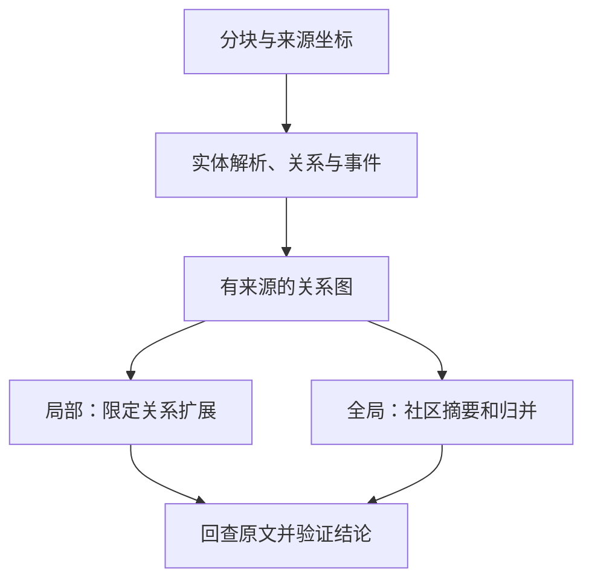

## 为什么有些问题一直搜不到一段完整答案

一个集团的员工问「过去三个季度哪些单位受设备供应商切换影响，后续流程有哪些共性？」单篇公告可能只写一个部门和一种设备。向量检索擅长找邻近段落，排名前几条可能来自同一部门，无法证明找齐了机构，更难概括分散事件的共同变化。图增强检索把实体、事件以及它们之间的关系显式保存，使系统能按关系扩展或按社区生成跨语料的概括。

GraphRAG 有多种实现。本文分别讨论有来源的**局部关系检索**和微软论文中面向全局问题的**社区摘要**。前者偏向有锚点、可逐跳核对的问题，后者把聚合表示预生成，适合问整个语料的主题。

## 建图时先定义关系和出处

从分块后的原文抽取组织、设备、供应商、变更事件与时间。定义「单位采用设备」「设备在某日切换供应商」这类关系，再做实体对齐。部门简称、人名、同名供应商必须在本机构、时间和业务语境内判定。每个节点和边保存来源段落或记录 ID、版本与候选置信度。多条冲突边可以并存，查询时根据时间和域规则决定如何报告，避免在入库时把冲突自动抹平。

属性图可将现实中的变更事件建成节点，而把设备、日期、旧供应商与新供应商连接到事件。相比直接写一条「设备有供应商」边，事件节点保留了因果尚未确定时的事实边界，并便于问「何时」「哪次切换」。实体在变更中的角色也是证据，不能把同段文字里仅共现的两个实体自动当作因果。

## 局部与全局怎样查

**局部问题**例如「A 部门在某日之后受哪次切换影响？」先消解 A 指哪个单位，再从该单位、设备或变更事件沿限定类型的边向外扩展。约束跳数、时间和边类型，保留每条路径对应的原文。一个路径里的边可能各有效，但时间并不重叠，组合结论必须另行校验。遍历候选应检查查询者能否访问边和证据，公开的节点名称不能暗示私有关系存在。

**全局问题**例如「这些供应商切换影响最深的主题是什么？」一种实现先从实体与关系图做分层社区划分，为每个社区建立摘要。在线阶段在多个社区摘要上产生局部答案，再合并、去重并组织全局回答。主题覆盖比最高相关片段更重要。摘要是派生材料，不能把某社区的总结当作唯一证据，关键声明需回查底层文档。单次文档更新可能牵动实体解析、边和社区摘要，成本比直接更新倒排或向量索引大。

## 与传统 RAG 怎样共用

型号、单条制度和精确引用仍适合普通混合检索。局部图查询可用词法或向量索引消解实体，图路径找到证据后回读原段。全局问题应对照分层抽样与常规多路检索，衡量主题覆盖、引用准确、关系错误率、P95 和增量重算成本。若源材料本身有明确结构和关联，优先利用确定性数据，生成抽取器只补缺口。

## 小结

局部图检索回答「哪些实体如何相关」，社区摘要扩展到「整份语料有什么主要主题」。关键是让关系有出处与时间，并评价图结构在目标查询上是否确实改善覆盖。

## 参考资料

- [Edge 等：From Local to Global，GraphRAG 原始论文](https://arxiv.org/abs/2404.16130)
- [Microsoft GraphRAG 文档](https://microsoft.github.io/graphrag/)
