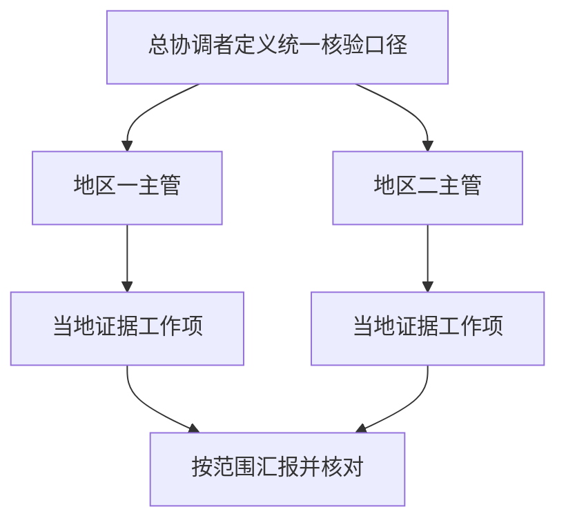

## 用组织边界组织任务树

集团要汇总三个地区的合同条款。上层只需要版本与覆盖结果，地区主管能访问当地索引并决定查证细节，执行者读取特定文档。分层把「在哪一范围决定下一步」交给最了解局部证据的层。设计中分清跨层契约和层内运行，否则顶层的一个指令变化可能让多个分支无序重跑。

### 如何传递最小权限和预算

父任务带源版本、地区或产品范围、阶段截止、剩余工具调用额度和验收规则。地区主管只允许创建本地区、指定资源的子工作项。假设总额度 40 次，给三个地区分别 12、12 和 10 次，剩余 6 次用于审查与补证。某个分支需要 15 次时，向上申请其余 3 次。所有并行申请由统一额度服务或拥有预算的节点原子分配。各子任务最长截止不能晚于父截止，预留总汇总时间。

地区回执包含已确认条款、版本、引用句段、覆盖范围与缺口。若底层文档不对总协调者可见，可提供允许共享的验收结果，并让有资格的审查人保存原文引用。父层只聚合收到的证据，无法独立核对的结论需明确标注。

### 局部故障与全局取消的处理

地区 A 最后一项查询超时，其主管重试或提供部分结果，地区 B 和 C 的可用产物可保留。上层调整整个统计期时，各分支都要接到新版本。旧回执不推进新任务。取消应向下传播并记录哪些工作已开始、完成或结果未知。采用层级前用最小样本对照单 Supervisor 的吞吐、分支隔离和故障归因，防止多一层就多一次重复生成和上下文复制。

## 小结

分层将组织约束变成任务树。每层负责所属范围的委派和验收，预算与权限沿父子契约传递，局部失败和全局取消由独立状态跟踪。

## 参考资料

- [Anthropic：Building effective agents](https://www.anthropic.com/research/building-effective-agents)
- [Claude 官方指南：Common architecture patterns](https://claude.com/resources/guides/building-effective-ai-agents/common-architecture-patterns)
