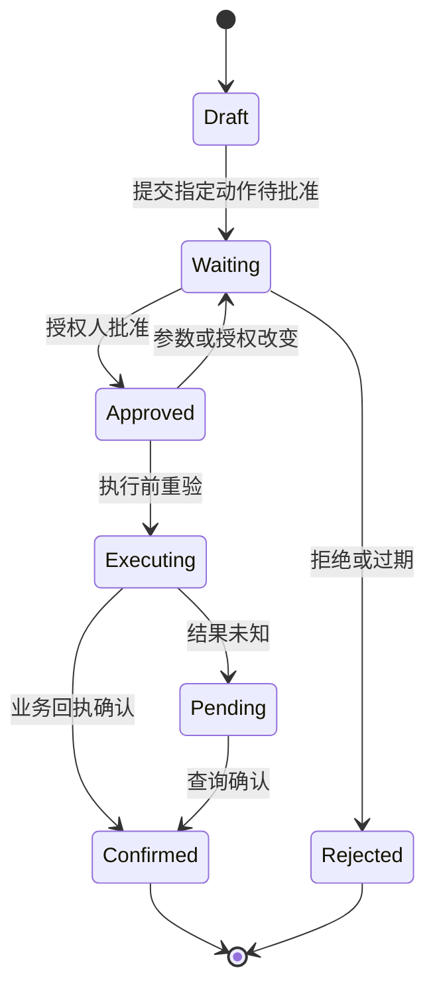

## 用户批准的到底是哪一次动作

采购助手整理出一份比价单，准备在业务系统提交申请。用户审批的是指定供应商、金额、币种、目标系统与用途组成的具体请求。若任务暂停期间金额由 10,000 变为 12,000，批准必须重新核对。批准动作可持久化为独立记录，绑定主体、批准人、动作 ID、版本、参数指纹、过期时间及理由。

### 保存等待状态，让进程可以退出

人工等待可以持续数小时，Worker 不必阻塞。编排器存下待处理动作、检查点和授权主体。审批接口验证身份，只有当前版本允许记录决定。使用并发版本检查处理「用户点了同意，同时管理员撤回任务」的情况。恢复节点先核查批准内容、生效期、当前对象状态和外部回执。可验证的信息优先读取可信系统，避免信任聊天中的「已同意」。

| 情况 | 程序应怎样处理 |
| --- | --- |
| 用户批准，参数和策略未变 | 执行前重验，提交并保存回执 |
| 参数改变或批准过期 | 回到等待，显示待核对差异 |
| 人工拒绝或撤回 | 停止该动作，保留已完成的只读产物 |
| 服务已写入但响应超时 | 核对同一业务操作 ID，明确最终状态 |

### 审批、确认和人工接管解决不同的问题

普通确认可消除「这个」指哪个对象的歧义。审批回答某人是否可以授权具体动作。人工接管则让人直接承担剩余任务。界面应展示证据和绝对时间，限制开放式自由文本修改，并提供拒绝和取消。安全规则决定哪些动作必须等待。评估人工介入时同时看等待时间、审批后重试、取消率和阻止错误动作的比例。

## 小结

人工参与应作为工作流的明确状态。批准绑定动作与版本，恢复核对当前权限与真实回执，拒绝与过期有各自出口。

## 参考资料

- [LangGraph 官方文档：Interrupts](https://docs.langchain.com/oss/python/langgraph/interrupts)
- [Anthropic：Building effective agents](https://www.anthropic.com/research/building-effective-agents)
