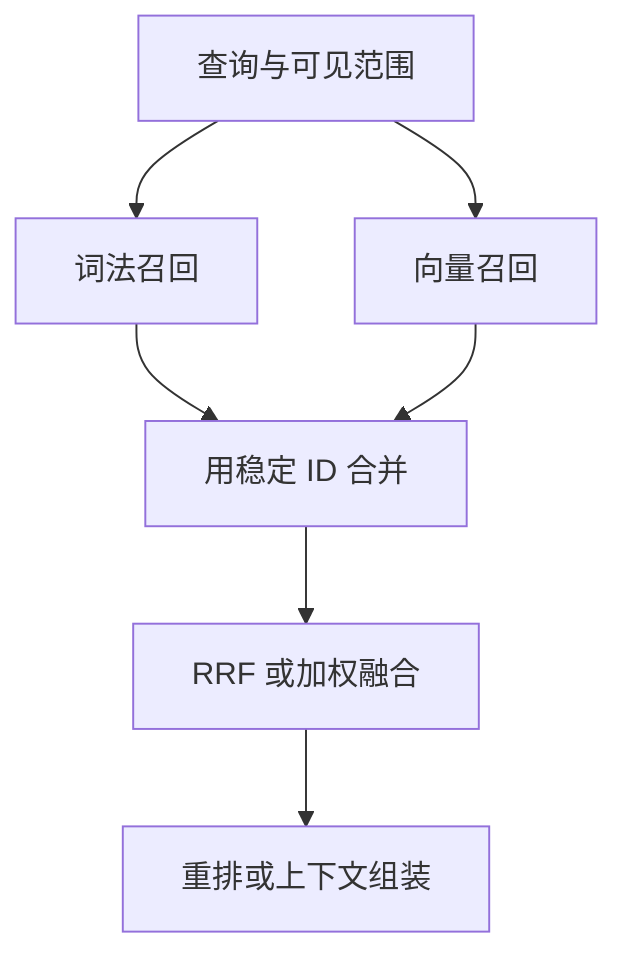

## 用户的问题同时含口语与编号

「E-7429 这个报警出现之后为什么机器不启动」既含精确型号，又含口语描述。词法检索可以找到错误码索引，向量检索可能找到使用了「启动锁定」措辞的知识段。两个来源必须在同一权限、版本和文档 ID 体系里返回候选。Hybrid Search 先合并证据候选，再按照设计的融合逻辑排序。它获得的是覆盖范围与信号互补，并不会自动让答案正确。

## RRF 怎样用名次代替原始分数

Reciprocal Rank Fusion（RRF）给各列表中的候选加入 1/(k+r) 的贡献，r 从 1 开始，未出现的列表贡献为零。k 调节前几名之间的差别。列表越截断，未出现就更可能意味着该路没有搜索到足够深，不能理解为已证明不相关。

设 k=60。词法结果为 A、B、D，向量结果为 C、B、A。A 的分数是 1/61+1/63，约 0.03227。B 两路都是第 2，分数约 0.03226。C 只有一路第 1，约 0.01639。B 虽两次只排第二，仍远超单路第一 C。若 C 是唯一正确的编号条款，这也说明 RRF 的共识偏好需要靠精确标识优先策略来约束。k 由验证样本选择，默认值不能代表所有语料。Tie-break 可固定为证据 ID 或可靠的业务信号，使结果可复核。

## Weighted Fusion 什么时候值得采用

如果能把各路的分数变成相容信号，可以使用 α×sparse+(1−α)×dense。Min-max 先在当前检索列表按最小和最大分数缩放。它简单，但单个极值会压缩其余候选。整路分数相同会产生零分母，应定义常量或丢弃该信号。空列表和列表截断候选如何记分也需明确。拥有标注集合时，可用查询特征、字段匹配、时间和分数学习融合，避免不同问题都用同一 α。要按文档类型、语言、编号与跨章节问题分层观察，不能只看一个总体平均。

## 候选池是混合检索的硬上限

例如词法和向量各取 20 条，去重后可能只剩 25 条。若正确来源两路都在 21 名之外，融合模型和重排器都无法恢复它。逐级记录候选 ID、原始排序、融合排序和最终上下文，先检查两路并集的 Recall，再检查融合后的 Recall 和 nDCG。若某路超时，允许按业务要求用另一条完成，并在轨迹里标记降级。上线时控制两路并发与独立时限，分别记录单路和联合的尾部延迟。

同一资料可能在多个索引中的粒度不同。一条向量子块和一个词法整节若未映射到稳定证据 ID，会被当作两条互不关联的结果。可以先在片段粒度融合再按父块去重，或定义同一选取粒度后再融合。这个决定也关系到 RAG 评估怎样数命中。

## 小结

先做多路召回与去重，再决定按名次还是校准后的分数融合。用编号和口语两类反例同时验证规则，让任何一路的高价值证据都能在候选阶段保留下来。

## 参考资料

- [Cormack 等：Reciprocal Rank Fusion](https://cormack.uwaterloo.ca/cormack/cormacksigir09-rrf.pdf)
- [Elastic 官方文档：Reciprocal Rank Fusion](https://www.elastic.co/docs/reference/elasticsearch/rest-apis/reciprocal-rank-fusion)
