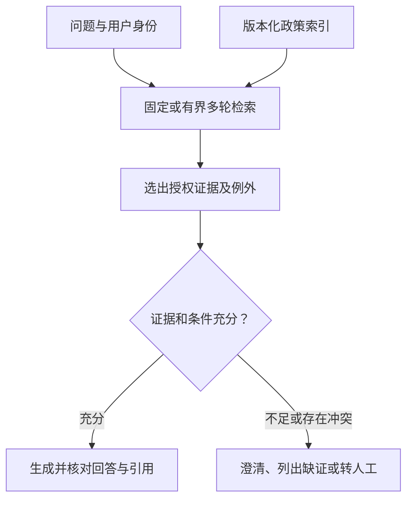

## 定义项目交付物和边界

企业员工经常询问「显示器从深圳部门划给北京部门，需要谁签字？」手册来自多个部门，版本并存，员工能查看的条款因租户和身份而异。系统要给出流程、来源与适用条件，必要时询问金额、生效日期或资产类型。第一版只提供建议和来源。预期交付是可核对的回答、明确的缺证说明或有依据的澄清问题。

为回答定义一个验收对象：问题中的主体与时间、可见证据、说明的业务条件、引用、未知信息以及升级人工的触发条件。若本题授权范围没有现行政策，不可以拿过期版本填补答案。若工单需实际执行，另定义提交、审批和回执流程，避免问答和权限产生模糊。

## 从需求变成数据与执行设计

入库负责解析 PDF、Word 与页面资料，标记版本、生效期、可见范围与源坐标。以段落和表格行为证据单元，带标题路径；按父子关系保存例外、图表与正文链接。双路召回同时照顾「设备划过去」和明确资产编号。常见简单问答走一轮固定检索。对于必须查海外子公司条款或检索范围尚不明确的情况，可先进行澄清或在严格授权和预算下发起第二轮查证。

查询层使用服务端会话身份生成过滤，返回候选的记录 ID、版本、来源和值。重排根据问句判断相关性，上下文组装保留一条通用和一条例外。生成输出要求按结论关联出处，并对缺证部分单列。引用检查验证其来自本轮授权证据，业务规则检查日期、主体与金额范围，再按最小量日志记录走过的状态。

## 一条问题怎样顺利交付

假设深圳和北京同属法人，当前制度写「跨部门调拨由接收部门负责人审批」，另有「金额超 5 万元应由财务复核」。若用户未报金额，答案可以给出通用审批角色，同时把财务复核条件标为条件结论并保留原文。若两份资料给出不同阈值，检查生效日和适用法人规则。若两者均有效且无优先关系，显示冲突并引导人工核对。不可用只观察相似度或生成器自信度来选择一份材料。

## 怎样验收、排障和迭代

建立代表性样本，需要有标准证据、可答性和业务时间。覆盖口语、编号、多段例外、旧版、撤权、纯扫描件和无证。比较全文输入与混合检索，逐层检查证据解析、授权后候选、最后上下文和引用支持。每次定位最早错误时记录来源、版本和结果，关联到对应数据或模型变更。先用工具回放测恢复与访问策略，再考虑给特定场景增加自治。成本和尾部延迟按一轮、两轮及异常分开测量。

## 小结

从验收条件反推项目，能够明确什么交给 RAG、什么交给业务规则、什么必须澄清。成功的政策问答首先要求一个可核对、可追踪且授权的证据链。

## 参考资料

- [Lewis 等：Retrieval-Augmented Generation](https://arxiv.org/abs/2005.11401)
- [Anthropic：Building effective agents](https://www.anthropic.com/research/building-effective-agents)
