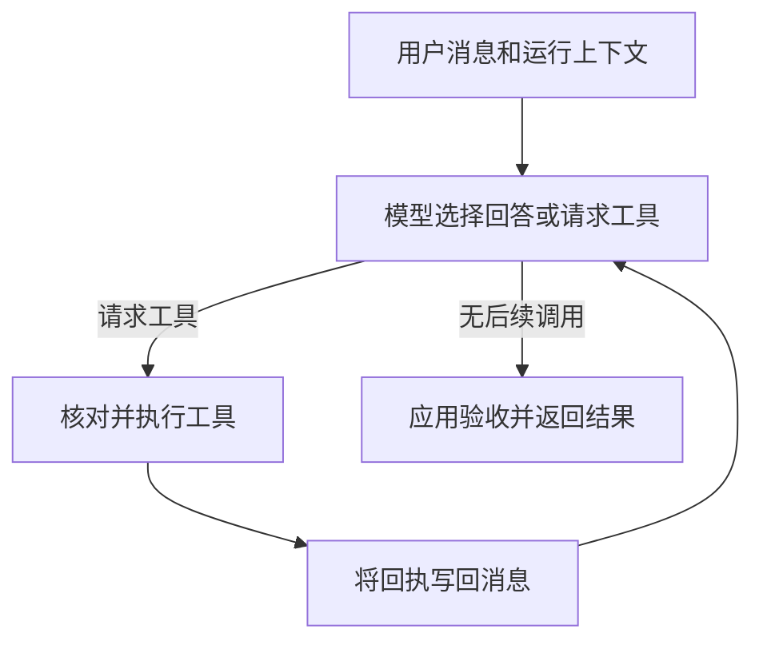

## 从固定顺序转向观察驱动

用户问「报销单 C-27 卡在哪一步」。模型需要决定先查单据，随后可能读审批制度。LangChain Python v1 的 `langchain.agents.create_agent` 将模型节点和工具节点组织为 LangGraph 运行时中的默认循环。应用传入初始消息。模型返回工具请求时工具节点执行，回填对应的工具消息，模型继续用获得的观察生成结果。

## 在模型前后和工具执行处处理不同判断

在模型调用前，应用可按身份和任务裁剪工具、注入验证过的描述或限定成本。工具调用边界适合检查主体、参数和当前资源权限。模型输出后可做格式和引用验收。v1 的 middleware 提供在这些边界接入逻辑的方式，具体钩子以项目采用的实现为准。不要用模型参数提供租户身份，也不要把中间件里的调试日志当作业务回执。

例如模型拿到了查单工具，但 C-27 属于另一租户。工具返回可安全表达的拒绝，模型据此请求可访问的单号。若同一轮还查询制度，按调用 ID 关联各自结果。为外部写入准备独立批准和幂等标识，避免模型重试或检查点恢复触发重复业务操作。

## 哪些编排应移到独立图

普通工具循环可继续使用高层入口。企业任务如果要并行核对两个索引、合流后等待审批、再提交并核对回执，独立 StateGraph 能表达各阶段的状态所有权。旧项目的 `langgraph.prebuilt.create_react_agent` 属于较早入口，架构迁移应先判断是否只需替换高层 Agent 入口，再比较状态、工具消息、持久化和审批行为。

## 小结

`create_agent` 提供标准工具循环，中间件扩展调用边界，LangGraph 提供底层编排。应用负责可信身份、业务授权和任务验收。

## 参考资料

- [LangChain v1 发布说明](https://docs.langchain.com/oss/python/releases/langchain-v1)
- [LangChain Python：Agents](https://docs.langchain.com/oss/python/langchain/agents)
- [LangChain Python：Middleware](https://docs.langchain.com/oss/python/langchain/middleware/overview)
