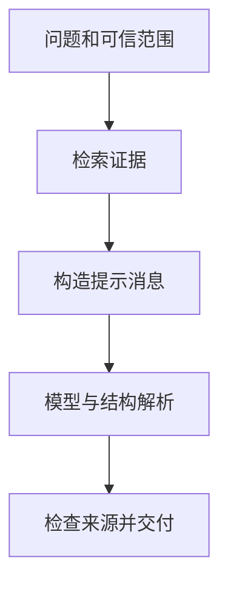

## 固定问答链的每一站交换什么

同事问「苏州出差住宿上限是多少」。已知的路径是检索文档、生成答案、验收引用。LangChain 的 Python 核心组件可以把这条路径组合成可调用对象。先把可信主体和生效日期交给检索适配器，检索返回文档及来源信息。Prompt 模板用这些资料填充一组消息，Chat Model 返回模型消息，解析器或结构化输出适配负责提取字段，最后以本轮证据验证引用。

## Runnable 和 LCEL 如何组织调用

Runnable 是组件接口。用 LCEL 的 `|` 可以把前一组件的输出交给后一组件，字典组合可以在共享输入上并行构造字段。比如把问题同时交给检索和保留原始文本的分支，再组装 `question` 与 `evidence`。链路仍要把可信身份保存在服务端，避免从模型生成的字典读取授权信息。

| 边界 | 输入 → 输出 | 可独立验证的问题 |
| --- | --- | --- |
| Retriever | 查询 → 文档列表 | 授权过滤、版本与候选覆盖 |
| Prompt | 问题和证据 → 提示消息 | 指令和资料边界、缺证规则 |
| Chat Model | 消息 → 模型消息 | 拒绝、工具请求与服务错误 |
| 解析和校验 | 模型消息 → 可消费记录 | Schema、引用来源及事实 |

`invoke` 表示单项调用，`batch` 表示多项输入，`stream` 则依赖参与组件是否支持分块传递。不要把 SDK 的批量接口等同于提供方的离线批推理服务。一个阶段必须收齐文档才能判断缺证时，可先返回可信查证状态，再开始流式生成。回调和事件可用于定位哪个组件付出了时间和成本。

## 组合到哪里应该停

如果查某地区政策只需一次检索，固定链更容易验证。若模型需要根据第一轮证据在文档、台账和澄清之间重新选择，Agent 循环更有意义。LangChain v1 将部分早期 Chain 实现移入 `langchain-classic`。旧博客里的 `LLMChain` 示例有版本背景，新项目可从 Runnable 或 v1 Agent 入口读起。迁移时先锁定输入输出契约，再比较分步回归结果。

## 小结

模型、提示、检索和解析通过组件契约连接。用 LCEL 表达已知路径，照实际组件能力设计并行、批处理和流式响应，最后用业务证据验收。

## 参考资料

- [LangChain v1 发布说明](https://docs.langchain.com/oss/python/releases/langchain-v1)
- [LangChain Python：Runnable](https://reference.langchain.com/python/langchain-core/runnables/base/Runnable)
