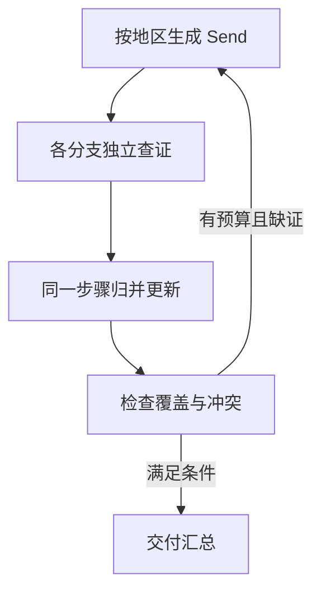

## 一个地区列表如何变成动态扇出

输入给出粤、苏、沪三个地区。每个工作者只需知道自己的地区、资料版本和任务 ID。编排节点可以在条件边返回多个 `Send`，将独立分支输入发到同一个查证节点。分支输出写入共享证据 channel，Reducer 以地区和版本合并，随后汇总节点判断哪些地区齐备。用实际任务集合区分「未派发」和「尚未返回」。

## superstep 与状态写入的时序

分支在同一步骤执行时，可以并行读、各自返回更新。其他分支在同一 superstep 的更新不应被假设立即可见。多个节点同时写同一值时，需要定义 Reducer 或分开字段。只拼接列表无法消除重复文档。按键保留可信版本，冲突则写入可复查记录，最终展示按地区排序。若业务想等若干静态前置节点全部完成，可显式声明合流依赖。若分支有不同长度或包含跳过路径，使用已登记工作项检查实际覆盖。

`Command` 可在节点返回时表达状态更新和下一跳。它与该节点既有静态边并行生效。组合方式应经过最小图测试，确认不会同时触发审批和提交两路。循环以有效证据、最大步数或截止时间停止。Graph API 的递归上限用来限制步骤，业务停止条件仍需明确。

## 子图怎样只暴露必要状态

若地区查证会反复执行检索、过滤与校验，可以封装子图。共享同名状态字段时，可以将编译后的子图作为节点接入。不同 Schema 时，用父节点包装调用并显式映射输入输出。跨子图向父图返回更新与路由时按文档核对目标和 Reducer。相同地区子图有多个并发调用时，核对实际版本的持久化模式和标识隔离，不共写同一会话状态。

配置 Checkpointer 后，某些同一步骤已成功节点的 pending writes 可供故障恢复使用。把模型调用和外部写入的生命周期与框架状态区分，针对乱序、重复和一个分支失败做回归。最终核对持久化页面上的版本与运行记录。

## 小结

Send 分派动态输入，superstep 界定可见状态，Reducer 和汇总条件决定结果，子图封装内部步骤。恢复逻辑仍需实际回执和任务契约。

## 参考资料

- [LangGraph Python：Graph API](https://docs.langchain.com/oss/python/langgraph/graph-api)
- [LangGraph Python：Subgraphs](https://docs.langchain.com/oss/python/langgraph/use-subgraphs)
- [LangGraph Python：Persistence](https://docs.langchain.com/oss/python/langgraph/persistence)
