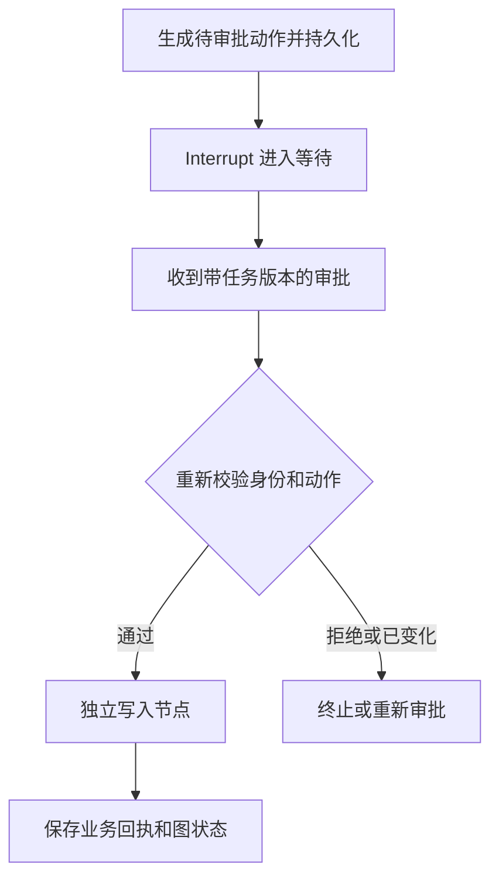

## 等人工批准期间不应让进程一直等待

一个咨询工单需经理确认后才能提交。模型已经收集证据并起草操作，下一步可能在几小时后才执行。进程内变量、HTTP 连接或对话全文无法可靠表达任务停在哪里。LangGraph 的 Checkpoint 机制按图执行步骤记录状态，Thread 为同一图运行的相关快照提供范围，Interrupt 允许明确停止并等待外部恢复输入。本文基于官方 Python 持久化与 Interrupt 接口的执行语义。

## Checkpointer 保存的是图运行状态

配置 Checkpointer 后，可把一次图执行的状态快照与任务位置关联到指定 thread_id，并按实现提供恢复、历史和状态查询。内存方案可用于本地试验，跨进程恢复需要共享的持久后端和适当的生命周期策略。Thread ID 不是身份凭证，调用恢复接口须重新核验任务归属和权限。角色或授权变化后，不能仅因旧状态显示已同意便继续。

历史回放是从已有状态或历史节点出发重新执行。重新调用模型、网络接口和读取的新版本数据可能得到不同结果。对需要可核查或可复跑的任务，应保存真实证据、模型配置、版本和回执。重放时取哪种数据要明确，不能把重放结果等同于当时执行过的事实。

## Interrupt 恢复为什么要考虑节点从头再跑

Interrupt 会暂停并等待外部输入。官方文档所述模式通常使用同一 thread_id，通过 Command(resume=…) 继续。恢复时被中断的节点可从开头重执行，interrupt 前的代码不能假定只执行一次。因此，将不可重复的写操作放在审批之后的独立节点，并且用稳定操作标识和幂等后端保护。节点在 interrupt 前若已创建待审批记录，需要确保重入能够读取同一记录而不再创建。

审批应绑定动作内容、任务版本、人员和有效期限。用户审批后，运行时仍需确认金额、目标和授权未变化。按一个布尔值继续执行可能让批准意图绑定到另一条后来改写的动作。可在更新后要求重新审批，拒绝时走明确的取消、退回或交给人工的分支。

## 练习怎样从失败恢复

设计三种故障：审批期间进程离线、执行成功但回执未保存、恢复时用户权限已变。第一种需要持久 Checkpointer 和同一线程关联。第二种要核对外部操作 ID，因为图状态不能证明业务服务是否完成。第三种应该阻止继续，按业务规则结束或请求有权者批准。对并行步骤还需检查已完成子结果能否复用，以及重复更新是否会被正确合并。

## 小结

Checkpoint 保存图快照，Interrupt 表达等待，Resume 把外部输入送回同一任务。外部副作用要靠授权和业务回执验证，并按节点可能重入设计。

## 参考资料

- [LangGraph Python：Persistence](https://docs.langchain.com/oss/python/langgraph/persistence)
- [LangGraph Python：Interrupts](https://docs.langchain.com/oss/python/langgraph/interrupts)
