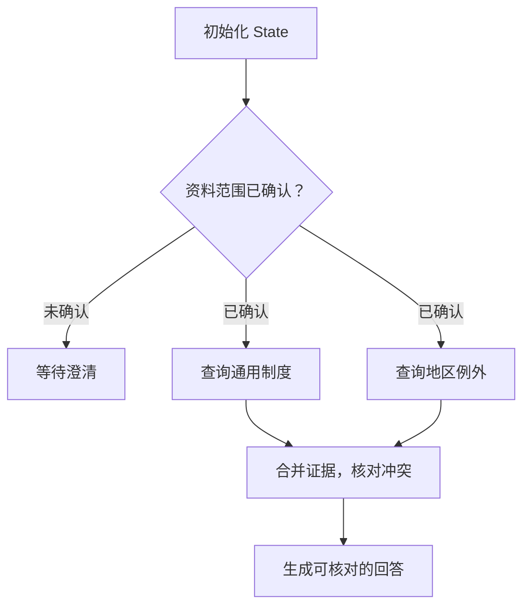

## 当工作流需要看见路径、状态和合并规则

一条政策核查要查通用制度和地区例外，两个步骤可并行，但回答必须等到两方面材料返回。用多层函数和异常捕获可以实现，随着追问、重试与等待变多，却很难看到完整的状态迁移。LangGraph 的 Python Graph API 将状态、节点和边分别表达。以下以官方 Python Graph API 所述机制为准，接口和持久化实现应随项目固定的版本核对。

## 状态告诉节点看什么，Reducer 告诉图怎样合并

**State** 定义在图中流动的数据和各字段更新语义。可包含请求、已确认参数、证据、审查状态和结果。**Node** 读取一份状态并返回部分更新。**Edge** 表示接下来运行的节点。条件边根据状态或节点结果选择分支。**Reducer** 为某个状态字段定义旧值如何与一个更新合并。未自定义 reducer 时，典型字段更新替换旧值，同一步多个写入需要用合适的更新模型处理。

例如两个搜索节点同时返回 evidence 字段，一方有地区政策，另一方有通用政策。若两个节点直接返回同名覆盖值，不能假定谁最后返回谁就是正确结果。可以对 evidence 使用按 ID 合并的 reducer。若重复运行或回放可能拿到相同资料，它需要去重并保留版本，出现冲突标为待核对。对于只有一个所有者的 decision 字段，可集中在验收节点更新。

## 条件边、Command、Send 与 Subgraph

只有路由需求时，可用条件边在「补充信息」「并行查询」「完成」等路径中选择，明确未知输入的默认分支。官方 Graph API 中，Command 可以在节点中同时返回状态更新和跳转，但使用时需检查现有边是否还会触发，避免同处声明重复路径。Send 适用于运行时才能确定分发项数的场景，例如根据政策涉及的地区数为每项构造独立输入并汇总。为每支任务保留子任务标识，合流时区别空结果和没有完成。

子图适合将某类政策处理封装。若上下游共享键，可以直接在外图节点中复用子图。私有状态或不同结构时，经包装节点显式映射输入输出。定义哪些证据、失败和运行状态需要返回父图，防止将中间的上下文和长文本无意写入父状态。

## 图边和模型的控制范围

图负责哪类动作可发生、何时并行和何时等待。节点可以用代码规则，也可以调用模型提出候选。工具权限、证据版本和提交判断在相应的节点中明确执行。用 Checkpoint 保存状态后，恢复需遵循节点重放和外部副作用的契约，详见同系列恢复主题。无论是否使用框架，Shared State 的所有权、归并规则和失败语义都应写出来。

## 小结

用 State 表达数据，用 Node 表达更新，用 Edge 表达调度，用 Reducer 管理合并。先建模工作流，再把模型能力放到确有需要的节点内部。

## 参考资料

- [LangGraph Python 官方文档：Graph API](https://docs.langchain.com/oss/python/langgraph/graph-api)
- [LangGraph：Subgraphs](https://docs.langchain.com/oss/python/langgraph/use-subgraphs)
