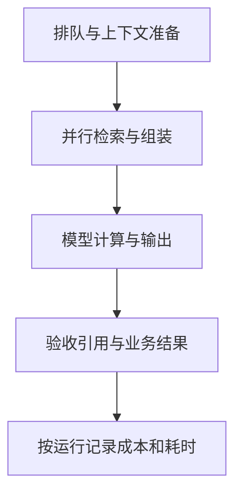

## 用户等待的究竟是哪一段

一个政策助手先排队，再查两套索引、重排、组装证据，最后生成。记录接收时间、开始执行、首个可读输出、模型结束以及业务验收结束。将两路检索置于同一 Trace，才能看到关键路径和共享队列的影响。若首个事件只是「已接收」，不要把它计作首个回答 Token。

假设单次运行排队 90 毫秒，两路并行检索耗时 80 和 140 毫秒，重排与组装 110 毫秒，模型开始后到首 Token 为 480 毫秒。在所有路径需要完成且无额外并发开销时，首 Token 约为 820 毫秒。把 80 毫秒分支加快至 40 毫秒对这次关键路径没有作用。生产中用整体运行记录算 P50/P95，再检查具体慢请求。各组件 P95 通常不能直接相加。

## 将 Token 成本落到一次任务

设一轮模型调用使用 6,000 输入 Token，其中 4,000 命中某提供方的前缀缓存，输出 600 Token。用假设单价，普通输入每百万 2 个计价单位，缓存输入 0.5，输出 8。本轮费用为 (2,000 × 2 + 4,000 × 0.5 + 600 × 8) / 1,000,000 = 0.0108。应按实际提供方区分缓存读写、计价类别与失败调用，并加上工具、存储和网络成本。最终按有效任务数统计单位成本，记录各类样本的质量。

| 干预方式 | 如何测试 | 容易损失的内容 |
| --- | --- | --- |
| 减少提示和上下文 | 固定证据追踪覆盖、输入 Token 和首答 | 条款例外与出处 |
| 复用稳定输入前缀 | 记录缓存类别与实际命中 | 提供方条件、隔离与有效期 |
| 小模型先处理明确任务 | 对照任务类型、升级率和最终成功 | 边界问题和复杂推理 |
| 控制并发、批处理与排队 | 按负载测吞吐、队列和尾延迟 | 单次交互响应与公平性 |

## 用上线门槛验证节省是真的

从首 Token 和总耗时中选出产品实际约束，再对改动做对照。成本下降但证据支持率下滑时，按问题类型回退或恢复必要资料。缓存答案要把租户、权限、生效日和索引代纳入合法复用判断。长任务使用阶段预算，达到上限后交付可核对证据与缺口。成本优化与质量回归共用任务集和版本标签。

## 小结

先用 Trace 找关键路径，再按实际账单和任务成功计成本。压缩、缓存、路由及并发都应在相同验收下比较。

## 参考资料

- [OpenTelemetry：Traces](https://opentelemetry.io/docs/concepts/signals/traces/)
- [OpenAI API：Prompt caching](https://developers.openai.com/api/docs/guides/prompt-caching)
