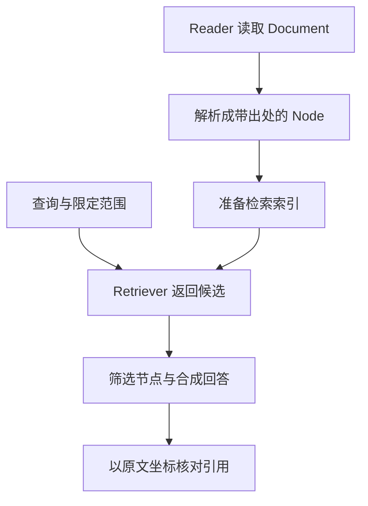

## 先追踪一条证据，再选择框架入口

财务手册里一条报销限制在标题和表格的交界。Data Connector 或 Reader 将来源读成带元数据的 Document。解析把手册拆成 Node，继承文档 ID、版本与标题层级。索引用于按策略查找这些节点。约定节点的来源标识比从模型文字里猜引用稳健，尤其是表格需要保留行列和单位时。

## 从两次输出区分检索问题和生成问题

Retriever 负责给出候选，可独立测当前适用条款是否在前 K。Query Engine 常把查找、节点后处理和 Response Synthesizer 组合起来。合成阶段在上下文与模型预算内组织候选，也可能处理多块内容的依赖。输出携带的来源节点使应用能够核对来源，但不能说明每条回答都真正受某节点支持。

假设 `N-17` 写着现行上限，`N-19` 写着远程地区例外。如果 N-19 根本没进入召回，检查元数据过滤、查询或索引。如果召回有 N-19 而输入预算截掉它，检查节点后处理和组装。如果生成输入齐全仍漏它，检查合成策略与引用验收。这三个检查在路径上分开记录。

## 何时需要事件工作流或 Agent

单轮问答可从 Query Engine 起步。显式执行「两路召回、合流、必要时人工确认」时，事件驱动 Workflow 可描述何时触发步骤以及携带哪份数据。在工具选择由新证据决定时，再把查询能力作为 Agent 可调用工具。LlamaIndex 提供这些抽象，底层存储的隔离、事务或恢复能力取决于实际组件。

验证两项变化。若文档变版，检查旧块是否正确失效。若权限改变，检查查询、源文档回读和缓存是否同时缩小范围。固定一组带来源的查询，回归 Node 覆盖、答案支持和尾延迟。

## 小结

LlamaIndex 的优势在于把读取、解析、索引、检索和合成拆成可组合的边界。保存节点版本和原文坐标，才能把数据层错误与生成错误分开。

## 参考资料

- [LlamaIndex：High-Level Concepts](https://developers.llamaindex.ai/python/framework/getting_started/concepts/)
- [LlamaIndex：Querying](https://developers.llamaindex.ai/python/framework/understanding/rag/querying/)
