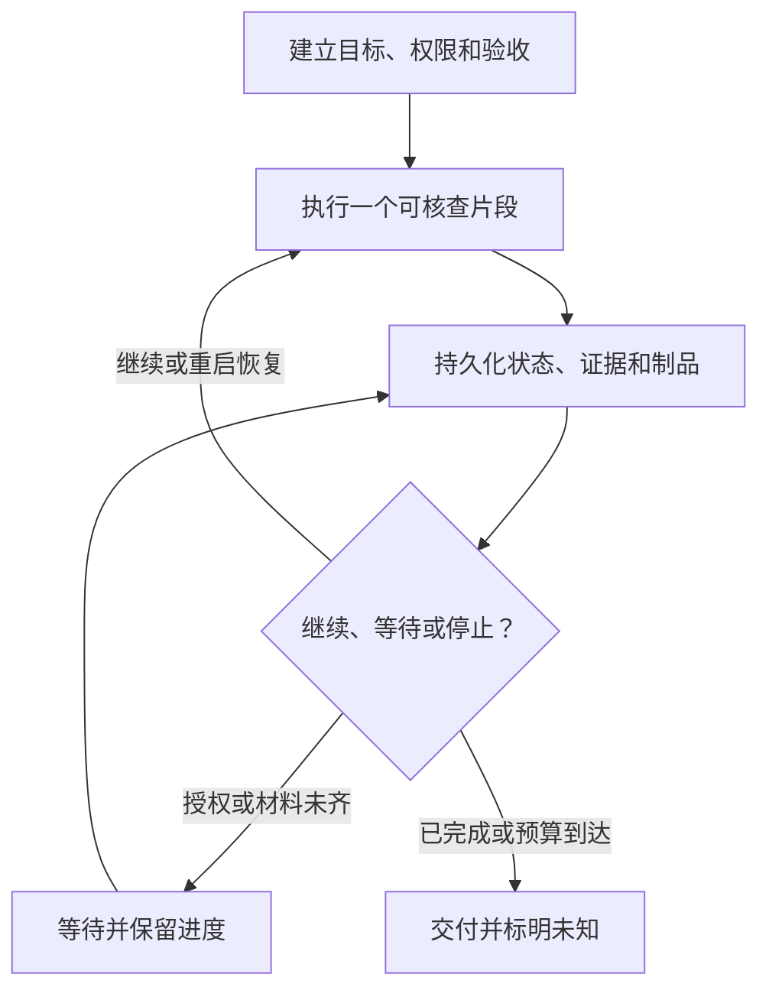

## 数小时任务为什么不能只要求模型「继续」

一个研究项目需要先收集资料，再对照冲突说法，最后交付引用可靠的说明。模型窗口有限，运行还可能换 Worker、被暂停或遇到新资料。如果下一轮只有「我们已经做了一些研究」的摘要，它无法知道哪些事实已验证、哪些只是设想、哪些工作正在进行。长时运行需要把进度放在模型会话之外，让新的执行单元可以按同一目标和证据继续。

## 持久化三类东西，恢复时各取所需

| 对象 | 记录内容 | 恢复用途 |
| --- | --- | --- |
| 任务合同 | 目标、交付、授权、预算、版本和退出条件 | 恢复本次约束，核对是否需要新授权 |
| 可验证的执行状态 | 已完成里程碑、待处理项、动作 ID、证据引用、最近观察 | 知道下一步以及哪些操作可复用 |
| 制品与日志 | 草稿、可回查的资料、检查结果、变更记录 | 重建上下文，复核事实和写入 |

简洁交接摘要可以帮助模型快速进入状态，但真实来源和事件记录仍是事实依据。为每一步保存可直接检查的退出条件，例如「找齐三份资料」应记录来源 ID、归属及时间，「结论被验证」保存哪条证据支持哪个结论。新会话按计划选择下一项前，先读制品与未完成项，再确认目标和授权仍然适用。

## 设计可恢复的自治而非一直运行

将长任务拆成可验收片段，每段独立确定输入、成果、超时和终止。需要并行时为任务设租约与版本检查，Worker 失联后能由新执行者接手。旧 Worker 恢复也不能继续覆盖新结果。对外发送和写入分别绑定操作 ID 与回执。进度信号应看里程碑与新增证据，不看生成 Token 或调用次数。用户调整任务后，保留有效资料，重跑依赖旧目标的阶段。

为上限提供可观测的状态。证据和算力达到预算则结束或申请授权追加。超时或重复动作触发有界失败，展示可检查的已完成成果。权限变化应停止依赖该权限的后续动作，对已经保存的资料采用最新访问控制。尤其是从文本、网页或其他 Agent 获得的材料不能自行提升工具权限。

## 哪些机制相对成熟，哪些还在验证

持久化工作流、队列、幂等写入和任务租约是已经广泛使用的工程机制。在若干小时的复杂工作中，怎样自动选择恰当里程碑、生成不会引入错误的交接摘要、长期防止目标偏移，需要针对任务与模型实测。评估可比较固定工作流与更自主策略，通过故障注入观测重启后的真实完成情况、重复动作、成本及保留证据。能在例子里运行很久并不能单独说明适用性。

## 用两次恢复核对长任务持久化

设研究任务已经完成两个维度的查证，第三个维度等待资料授权。重启后先读取已验收制品与剩余工作，不从聊天摘要重新搜索。第一次恢复时确认授权仍有效，继续第三个维度。若第二次恢复时权限已撤回，保留允许保留的历史进度，并按当前规则跳过不可访问材料或交给人工。状态恢复解决任务连续性，来源权限仍需要按实际时间核对。

## 小结

长任务的核心是可恢复进度和可核验交接。任务合同、持久状态、制品与权限一起决定下一轮还能做什么，以及何时应停下。

## 参考资料

- [Anthropic：Effective harnesses for long-running agents](https://www.anthropic.com/research/effective-harnesses-for-long-running-agents)
- [LangGraph 官方文档：Durable execution](https://docs.langchain.com/oss/python/langgraph/durable-execution)
