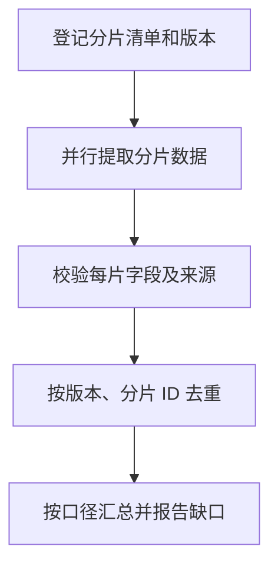

## 怎样在文档量增长后维持可核对性

要汇总三个地区的企业服务月报。每个地区的文档可以独立抽取工单总数、解决数和异常项。Map 节点输出结构化分片结果与来源 ID。Reduce 根据共享统计口径做合并，避免把模型生成的摘要直接当作统计结果。与分片规则固定的 Map-Reduce 相比，动态 Orchestrator 可根据输入决定分片。后者需要额外验证分片是否重叠或漏掉目标范围。

| 地区 | 已解决 | 工单总数 | 当地解决率 |
| --- | ---: | ---: | ---: |
| A | 90 | 100 | 90% |
| B | 9 | 10 | 90% |
| C | 3 | 10 | 30% |

总解决率为 102 / 120，即 85%。三个当地百分比的算术平均是 70%。如果只返回「解决率」，就无法复原正确全局指标。保留原始分子分母、统计期、类别版本和可访问的引用。若三个分片的工单重复，按稳定实体 ID 去重后再计算，或证明数据分区彼此独立。模型可摘要异常叙述，计数和口径以确定规则验证。

### 控制并行、局部失效和可追踪性

分片较多时有界并发可以保护共享 API。Reduce 只等启动时登记的分片，在总截止时间后按明确标准定为部分成功或不交付。重跑地区 C 时，旧 A 和 B 在时间和版本一致的前提下复用。将最终汇总附上参与分片和缺口，防止重复计算或「数据完整」误标。若来源跨地域保密，Map 只上行符合访问契约的字段，最终产物仍按权限检查。

## 小结

并行能加快独立分片处理，可靠汇总依赖稳定 ID、同一口径和可回查证据。先验证分片与数据契约，再决定是否使用生成式汇总。

## 参考资料

- [Dean 与 Ghemawat：MapReduce](https://research.google/pubs/mapreduce-simplified-data-processing-on-large-clusters/)
- [Anthropic：Building effective agents](https://www.anthropic.com/research/building-effective-agents)
