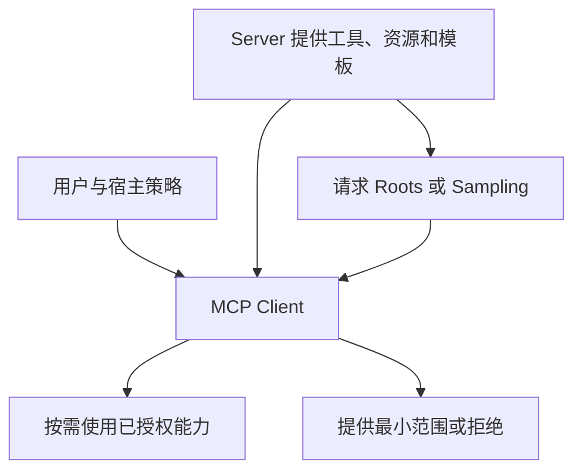

## 同样来自 MCP 服务，为什么处理方式不同

公司有一项政策文档、一种审批草稿模板，以及一个用来实际提交的工具。三者都可在 MCP 服务中提供，但用途不同。**Resource** 提供应用可选择加载的数据。**Prompt** 提供可获取的消息模板，通常由用户选择。**Tool** 声明可调用的函数，模型可以建议使用，宿主决定是否执行。若将全部能力都做成任意调用工具，会丢失何时读取、何时主动确认、哪些动作有副作用的区分。

| 能力 | 提供方向 | 一次交互的例子 |
| --- | --- | --- |
| Tools | Server 向 Client 声明 | 宿主请求查询政策或提交待审批事项 |
| Resources | Server 向 Client 提供数据 | 应用按 URI 读取已授权规则文档 |
| Prompts | Server 向 Client 提供模板 | 用户选择生成交接说明，再填入具体参数 |
| Roots | Client 向 Server 提供工作范围信息 | 让本地文件服务知道应操作的目录 |
| Sampling | Server 在协商后向 Client 请求模型生成 | 服务请求宿主生成材料摘要，宿主控制是否接受和用哪个上下文 |

出于阅读或编辑用途，服务可把某文档作为 Resource，并另提供有权限校验的 Tool 处理该文档。工具返回还可能链接资源，但宿主应按 URI 和权限独立校验读取，不能因为资源是工具返回的地址就认为自动获准。Prompt 模板来自服务，进入模型上下文仍受宿主信任策略限制。

## Roots 和 Sampling 为什么要求宿主参与

Roots 表达宿主提供的工作目录范围，帮助服务理解和尊重用户工作空间。它不是独立的文件系统强制机制。强隔离由系统账户、目录权限、容器或沙箱实现。在共享团队中，每个会话只提供最小工作范围，不能把路径列表或工作区外文件当作任意数据来源。

Sampling 允许服务请求客户端发起模型生成。是否允许、所用模型、是否包含额外上下文、成本和结果如何回给服务器都应由宿主审查。服务请求中出现的指令及内容处在外部信任边界。不要在采样时自动携带无关会话历史、其他服务凭据或用户文档。某些支持项依赖协议版本和能力协商，调用前应检查双方能力。

## 从能力声明走到安全执行

选择工具时，从服务身份、经过审核的工具说明、当前用户授权和动作风险推导可用列表。参数校验只是一层，服务器也应验证授权、资源归属和幂等。对于敏感读取或写入，记录动作摘要并可按策略申请批准。权限更新时同步更新缓存、候选列表和底层数据。工具和资源响应只提供信息，没有权力要求应用开新通道或添加权限。

版本敏感的开发先约定支持协议及传输，再按实际协商结果测试未声明能力、列表变化、断开重连、安全拒绝和数据最小化。应用也可以即使服务支持 Sampling 仍禁用，用可见且明确授权的方式提供相同业务功能。

## 从旧服务端请求迁移到 MRTR

以工具需要核对合同年份为例，2025-11-25 在协商后可由服务发起对应请求。2026-07-28 使用 MRTR 将补问包含在 `input_required` 结果中，由客户端请求用户输入，再在续发调用中带回 `inputResponses` 和相关状态。Roots、Sampling 与 Logging 在 2026-07-28 已标记弃用。现有项目用能力和版本判断兼容行为，新项目应依据所需功能选用保留的能力与扩展。协议层的申请不授予文件读取、模型上下文外发或业务操作权限。

## 小结

读资料使用 Resource，获取交互模板使用 Prompt，执行动作使用 Tool。Roots 和 Sampling 是客户端提供的能力。所有可选交互均要经过协商和宿主策略。

## 参考资料

- [MCP 2026-07-28 发布说明](https://blog.modelcontextprotocol.io/posts/2026-07-28/)

- [MCP 2025-11-25：Server capabilities](https://modelcontextprotocol.io/specification/2025-11-25/server)
- [MCP：Roots](https://modelcontextprotocol.io/specification/2025-11-25/client/roots)
- [MCP：Sampling](https://modelcontextprotocol.io/specification/2025-11-25/client/sampling)
