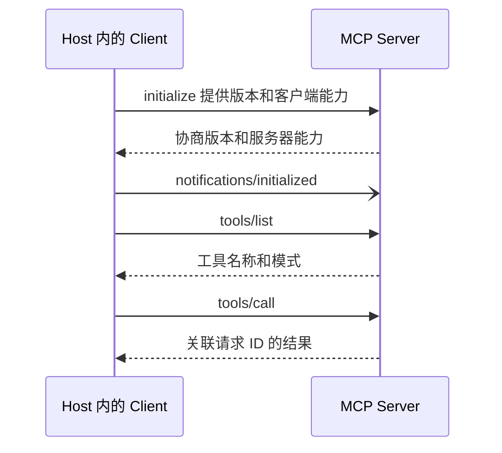

## 为什么接了五个工具服务，宿主还要写五套适配

企业助手需要查询政策、查工单和获取文档元数据。服务都是进程或 HTTP 接口，名字、可用能力和消息方式不同。MCP（Model Context Protocol）定义宿主如何以共同协议接入服务，发现上下文与工具能力。本文以公开的 2025-11-25 版协议为例。实际客户端支持的能力由协商结果决定。

**Host** 是承载交互、模型和策略的应用。Host 内的 **Client** 管理与 MCP 服务的一条逻辑连接并遵循生命周期。**Server** 提供工具、资源或提示等能力。一个宿主可维护多个客户端接入不同服务。宿主决定哪些服务数据进入上下文，哪个身份可调用，以及这些能力是否对模型可见。

## 初始化不是一次可跳过的握手

消息使用 JSON-RPC 2.0。请求有 ID，响应使用同一 ID；通知没有 ID，也没有对应的 JSON-RPC 响应。创建传输后，客户端先发送 initialize，携带协议版本、应用信息和能力。服务器回复支持的协议版本、服务信息和能力集合。如果版本不相容或关键能力缺失，应用应停止或走受控降级。客户端随后发送 notifications/initialized，连接进入正常操作。只有协商过的可选能力才能按规范使用。

对于工具调用，客户端可通过 tools/list 获取名称、说明和输入模式，再以 tools/call 请求服务执行实际操作。列表的缓存、更新通知和分页行为依规范与能力声明处理。协议级错误和工具执行返回的错误状态不同，前者描述请求或协议问题，后者描述工具操作失败。接入多个服务时，用服务身份和工具名共同标识能力，避免同名工具被错误路由。

## stdio 和 Streamable HTTP 差别在哪里

stdio 通常由客户端启动本地服务器进程，通过标准输入和输出交换 JSON-RPC 消息。标准输出应只传协议消息，日志一般走标准错误。远程使用 Streamable HTTP，通过规定的 HTTP 请求与可选 SSE 传输消息，服务器可提供会话 ID，后续按协议携带。它与早期 HTTP+SSE 传输存在版本差异，因此接入要核对部署端和客端工具的规范版本。部署端还应校验网络来源及身份，应用既不能凭传输可达授予工具权限，也不应信任服务返回内容中的指令。

## 与 Function Calling 和 A2A 的关系

Function Calling 表示「模型建议宿主调用这项能力」，MCP 表示「宿主如何发现并与外部能力服务交互」。两者可连接，也可单独使用。MCP 的 client 是 Host 管理的协议角色，并不表示独立 Agent。A2A 面向 Agent 或应用彼此交换任务与结果，预期的交互单元不同。在工程实践中要先确定需要工具接入还是跨 Agent 的任务协定。

## 小结

MCP 统一消息、生命周期和能力发现。宿主依协商结果接入服务，并本地贯彻数据最小化、授权、业务验收与审计。

## 参考资料

- [MCP 2025-11-25：Lifecycle](https://modelcontextprotocol.io/specification/2025-11-25/basic/lifecycle)
- [MCP 2025-11-25：Transports](https://modelcontextprotocol.io/specification/2025-11-25/basic/transports)
- [MCP：Tools](https://modelcontextprotocol.io/specification/2025-11-25/server/tools)
