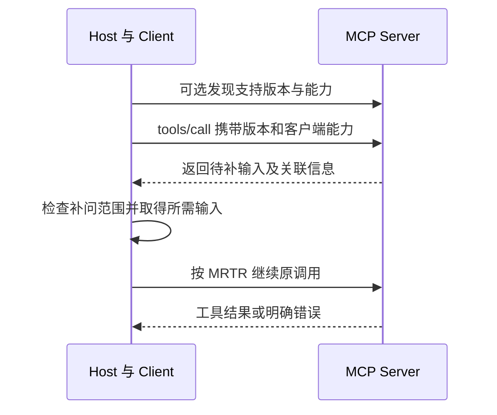

## 同一套工具，两种协议生命周期

假设一个助手通过 MCP 查合同条款，后面又调用生成比对草稿的工具。两个版本都用 JSON-RPC 2.0，也都区分 Host、Client、Server。2025-11-25 通过 `initialize` 及初始化通知建立连接生命周期。2026-07-28 把版本和请求所需能力放进每次请求，服务分别接受或拒绝各次请求。应用仍然可以保存草稿和任务，例如把草稿 ID 作为后续工具的显式参数。

| 工程问题 | 2025-11-25 | 2026-07-28 |
| --- | --- | --- |
| 约定版本与能力 | 初始化阶段协商 | 每次请求声明版本与能力，可预先发现 |
| HTTP 调用 | 参照对应 Streamable HTTP 规则，服务可分配会话 ID | POST 请求独立，响应可为 JSON 或本次请求的 SSE |
| 服务向客户端索取输入 | 旧生命周期允许相应服务端请求 | 工具返回待补输入，客户端发起后续往返 |
| 长操作 | 旧版实验 Tasks 语义 | 通常先核对是否共同声明 Tasks 扩展，再按扩展追踪任务 |

## 沿一次现代工具调用阅读线协议

客户端可先请求 `server/discover`，然后按已知能力使用 `tools/list` 或 `tools/call`。请求的 `_meta` 含协议版本和客户端能力等协议元数据。现代 Streamable HTTP 把协议版本和用于路由的方法、工具名称信息放在对应的 HTTP 头，按规范保持头与消息体一致。Header 可帮助路由，访问控制应在服务端根据可信身份核对。服务报告不支持版本时，客户端可从支持列表选择双方均支持的版本并应用对应流程。

用只读合同查询举例。查询缺少合同年份时，工具可以通过 Multi Round-Trip Requests（MRTR）请求一个年份。宿主检查只询问该项，再将结果按规定带回。用户不愿提供时，宿主保留拒绝路径。涉及写操作时，要将批准绑定到实际参数，避免上一轮确认被另一个请求复用。Tasks 扩展的任务标识独立于协议传输，不同协议时代的 Tasks 不应直接互换。

## 无状态不等于任意复用

工具目录响应可提供 `ttlMs` 与 `cacheScope`。实现需遵守缓存提示，隔离不同身份、权限与版本。缓存失效是目录一致性问题，业务动作仍现场授权。Roots、Sampling、Logging 及旧式 HTTP+SSE 处于已弃用状态，旧连接的兼容行为应单独验收。已有项目先记录支持的版本和扩展，用只读调用、版本不匹配、用户拒绝和授权变化做迁移对照。

## 小结

2026-07-28 将 MCP 核心改为逐请求协商。应用仍需核对业务状态、动作授权、缓存范围和真实结果。兼容旧客户端时保留两套明确的协议路径。

## 参考资料

- [MCP 规范 2026-07-28](https://modelcontextprotocol.io/specification/2026-07-28)
- [MCP 版本与兼容性](https://modelcontextprotocol.io/specification/2026-07-28/basic/versioning)
- [MCP 官方发布说明](https://blog.modelcontextprotocol.io/posts/2026-07-28/)
