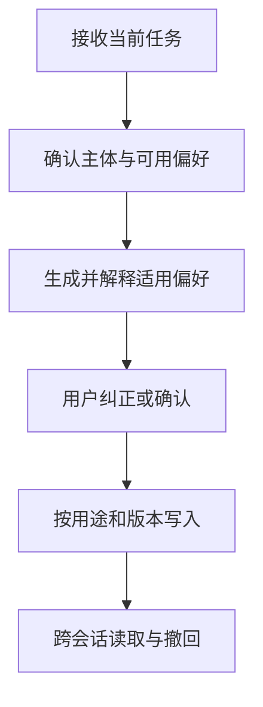

## 业务目标与最小范围

使用虚构团队例子。用户希望项目简报以表格表达风险，但偶尔需要面向客户发送短段落。系统只为用户保存可确认的写作偏好，例如「内部周报使用风险表」，不从见过一次表格推断永久喜好。输出是用户可看、可改、可删除的建议与草稿。业务事实仍从受控项目资料获取。

## 模块与执行路径

偏好记录可包含主体、用途、值、来源、确认时间、版本和撤回状态。对于「这份周报用句子」，仅修改当前任务参数。对于「以后内部周报都改成列表」，允许新的偏好版本。读取时先匹配主体和用途，再看当前请求是否明确覆盖。不要把团队风格与用户习惯写入同一个范围。

## 一次可验证的运行

用户甲确认内部周报使用风险表。下一次内部周报读取该偏好。对外材料仍按外发模板，不得复用内部风险字段。随后甲将偏好改为列表，旧运行能解释当时用了哪一版，后续读取只使用最新生效版本。若甲撤回偏好，应用在生成前基于权威状态剔除旧记忆，即便缓存还没有完成清理。

| 输入 | 预期行为 | 验收 |
| --- | --- | --- |
| 新会话的内部周报 | 取已确认偏好 | 实际输出采用风险表 |
| 本次明确要求段落 | 按本轮要求生成 | 长期偏好版本保持 |
| 乙提交相同任务 | 使用乙的配置 | 输出与 Trace 无甲的记录 |
| 甲撤回偏好 | 恢复默认 | 缓存失效期间也无法复用 |

## 小结

最小记忆系统从少量有边界的偏好开始。用用途、确认与撤回解释记忆决定，并以跨会话实际输出验收。

## 参考资料

- [LangGraph：Persistence](https://docs.langchain.com/oss/python/langgraph/persistence)
