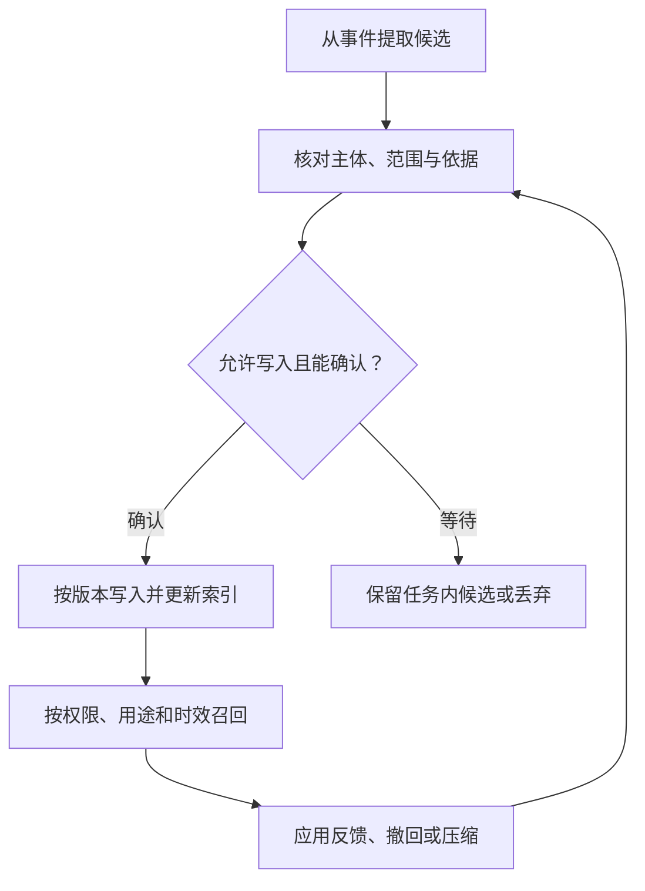

## 自动记忆先回答哪里需要保持连续性

用户今天说「下次默认查上海差旅」，后来又说「我换到广州了，出差默认按广州查」。第一次查询需要带着当前会话里的任务输入。换设备或关掉对话后，用户确认的默认城市仍可服务后续任务。保存整段聊天很难精确更新这条偏好，也会把无关细节带入新任务。可靠的 Memory 需要围绕明确用途保存可核查、可更新的条目。

例如偏好条目包含主体 `user-12`、用途 `travel.city.default`、适用范围 `国内差旅`、值、来源记录、状态、版本和生效时间。当本次明确要求查询北京，当前请求覆盖默认偏好。公司差旅上限来自 RAG 的现行制度证据，记忆只帮助补足用户输入。会话 State 中的审批是否完成，由业务状态负责。

## 从对话到可用记录

提取器可将「以后国内差旅默认按广州查」转写成候选字段，但模型提取不代表用户确认。记忆策略先分辨明确偏好、历史事件、待确认推断和操作步骤。密码、仅供当前任务使用的敏感输入和授权凭据不进入长期记忆。可信来源决定写入权限、数据保留期及能否跨任务使用。

| 写入事件 | 存储结果 | 新请求如何读取 |
| --- | --- | --- |
| 用户确认默认上海 | 同范围版本 1 生效 | 缺城市时可将上海用于查询 |
| 一次查询北京 | 单次任务状态或有保留期的经历 | 只在明确回顾时引用 |
| 用户改为广州 | 同范围版本 2 生效，版本 1 失效 | 新请求默认广州 |
| 用户撤回城市偏好 | 生效记录标记撤回，传播到派生数据 | 缺城市时询问或按产品规则降级 |

并发更新时让提交携带读取到的版本，两次对版本 1 的修改只能有一次直接成功。另一条重新读取当前值再决定是否合并。范围、来源或生效日期不能调和时进入人工或用户确认。有效时间和写入时间分开，有利于解释用户何时表达偏好以及何时开始适用。

## 召回、压缩和遗忘都是产品行为

有限类设置优先按键、主体与范围查询。需要回顾某次任务时，再用关键词或向量找相关经历，并过滤越域、失效和撤回记录。相似度不能决定租户权限或事实优先级。召回后将记忆以带来源的上下文传入，并设置 Token 预算和去重。对可能改变回答的偏好，以可核对方式展示或确认。

压缩把重复经历汇成可复用线索，应保留源 ID、时间和适用范围。转成程序记忆时，还需要验证流程版本和环境约束。源条目被撤回后，读取端可以先通过撤回状态禁止使用，再异步使摘要、索引与缓存失效。验收时重点检查两件事，一是误写和过时偏好是否会污染新任务，二是撤回后是否仍能从摘要或缓存召回相同信息。

## 小结

把记忆当成会变更的有来源数据。以明确目的提取、按权限写入、按用途与时效召回、按版本处理更新，并让撤回传播到派生数据。知识库负责外部证据，任务状态负责当前步骤，记忆负责经过选择的跨步骤或跨任务信息。

## 参考资料

- [Park 等：Generative Agents](https://arxiv.org/abs/2304.03442)
- [Packer 等：MemGPT](https://arxiv.org/abs/2310.08560)
