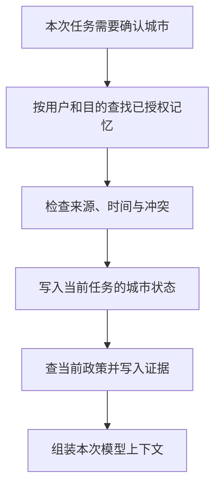

## 对话关掉后，要记住哪些东西

一位员工上周查过上海差旅规则，今天请求「沿用上次的城市，给我看看新的限额」。系统可能从会话中获取城市，也可能从已确认的过往任务中调取。保存整段历史有利于还原，却昂贵、难以授权，也容易用过期信息覆盖当前事实。记忆需要先决定未来会用于哪些任务、能保存多久，之后再按目的和授权检索。**Context** 是本轮模型看见的内容，**State** 保存当前任务运行进度，**Memory** 则提供可以跨调用或任务运用的信息。

## 哪种记忆表示适合哪类信息

| 类别 | 可以存的内容 | 取用时检查 |
| --- | --- | --- |
| Working Memory | 当前任务要用的临时目标、确认城市及近期证据 | 与本次状态一致，任务结束后按要求清除 |
| Episodic Memory | 带日期、来源和结果的具体事件，例如某次出差 | 与本用户相关、时间和结果可信 |
| Semantic Memory | 相对稳定的事实或用户偏好，例如用户确认团队缩写 | 来源、适用范围、更新时间与可更正能力 |
| Procedural Memory | 可复用的解题步骤、审核清单、成功运行轨迹中的操作方法 | 是否经过审查、权限、目标系统版本与适用条件 |

短期与长期主要按存储周期区分，语义、情节与程序则按内容及用途区分，同一条事实可以在某次任务里临时出现，在用户确认后才进入长期数据。程序记忆可以给模型一个操作建议，但不能把一次历史成功变成当前用户的授权。行为方法有变化时需保存版本和适用环境。

## 一次取用怎样落到实践

当前用户提出「沿用上次城市」。宿主先看本次任务是否已有一个明确选项。若没有，按用户范围读取近一次已完成、用途相容的出差事件，得到「上次确认城市＝上海，来源＝上次任务，日期＝某日」。模型如果看到同一月份另有「宁波」事件，应澄清「你指哪次」或使用可解释的最近且已确认规则。随后针对上海查最新政策。用户记忆参与决定查询参数，RAG 文档提供当前政策；同一个索引只负责相似性，不能自行区分已授权偏好和企业事实。

保存模型推断时尤其谨慎。用户说「朋友曾去上海」不等于本人把上海设为偏好。候选可以交给规则或用户确认，记录来源和明确的作用域。读取时结合标识、时间、语义和当前任务目的。展示、修改和删除要按数据策略传播到缓存和向量索引，避免更新后又被旧记录召回。长期助手应把用户标识与内容权限从模型调用中分离。

## 在同一条请求里画清三种数据边界

系统收到「跟上次一样，帮我确认这次出差的酒店上限」。短时状态保存本次查询 ID、已读来源和缺少的目的地字段，断点恢复时使用。工作上下文只取本轮需要的信息，其中一部分可来自上次已确认的城市偏好，这是长期记忆。酒店上限来自 RAG 检索到的现行制度，属于业务证据。如果用户明示目的地为成都，应按本次城市检索。如果只发现一个城市的历史交互而无确认偏好，系统可以向用户提问。三者会出现在同一模型输入里，但写入、保留和过期的条件各不相同。记忆如何可靠地更新与撤回，见[记忆生命周期](/agent-engineering/capabilities/memory-lifecycle/)。

## 小结

Working、Episodic、Semantic 和 Procedural Memory 各自回答不同问题。把当前事实、来源、用途和授权一起保存，读出的内容才能用于决策而不覆盖现实环境。

## 参考资料

- [Park 等：Generative Agents](https://arxiv.org/abs/2304.03442)
- [Packer 等：MemGPT](https://arxiv.org/abs/2310.08560)
