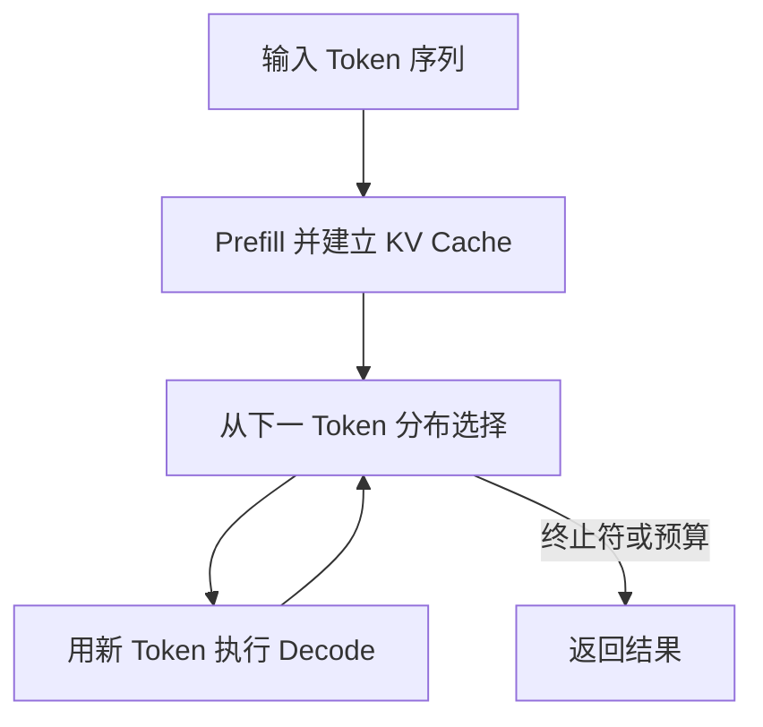

## 为什么迟迟才出现第一个字，之后却逐字输出

一次 Agent 请求可能带着 24 页手册和上百个工具定义。模型要先把输入 Token 处理一遍才能得到首个输出分布，随后每步根据新的序列继续预测。**Prefill** 主要处理提示序列，**Decode** 逐步生成 Token。排队、服务端调度和网络还会影响用户看到的延迟。观察时可区分首 Token 时间、相邻 Token 时间与端到端请求时间，用于判断瓶颈。

## KV Cache 省掉什么，又占用什么

在因果模型里，过去位置不能看见新 Token，所以已经算出的历史 K 和 V 可以留存。在解码下一步时，只为新增 Token 计算新的投影，同时读取历史 K/V 做注意力。缓存免去重复处理整段历史，却仍要存每层、每个保留位置的键值。以忽略分配开销的估算，每序列缓存字节量约为 2 × 层数 × 序列步数 × KV head 数 × 每头维数 × 每元素字节数。具有 GQA 或 MQA 的模型将多组查询共享较少 KV head，改变这一开销。

KV Cache 包含当前模型某次计算的状态，不是用来保存用户事实的 Memory。Prefix caching 可以让多个请求在受控条件下共享相同 Token 前缀的计算。模型、位置或前缀变化会使缓存不匹配。多租户项目还要用隔离策略处理缓存归属、生命周期和度量，以避免跨用户复用敏感提示。

### 比较 MHA、GQA 与 MQA 的显存量级

以 32 层、32 个查询头、每头 128 维、4096 个缓存位置、每元素 2 字节的模型为例。只计算单序列的 K/V 张量，不含临时激活、分页、对齐和框架开销。

| 结构 | KV 头数 | 单序列 KV Cache | 查询头如何使用 K/V |
| --- | ---: | ---: | --- |
| MHA | 32 | 2 GiB | 每个查询头有独立 K/V |
| GQA | 8 | 512 MiB | 每 4 个查询头共用一组 K/V |
| MQA | 1 | 64 MiB | 所有查询头共用一组 K/V |

GQA 保留查询投影的多样性，同时缩减 KV 读写量。缓存按序列长度和并发规模近似线性增长，批处理吞吐还受权重带宽、算力、分页和服务调度影响。不能从缓存缩小倍率直接推算延迟改进，也不能把共享 K/V 当作对任意已训练模型的无损开关。

如果应用发出 1 万 Token 的输入只提取一个条款，评估先按证据位置和输入长度分桶，再检查召回正确率及首 Token 时间。固定前缀复用、预先检索减小输入、把长任务拆成有可核对工件的阶段，是三种不同的成本来源干预。生成幻觉可以表现为「引用编号格式正确，却不存在于上下文」。温度调整改变采样分布，证据集校验负责事实边界。

## 采样如何从概率变成输出

输出头产生词表分数。Temperature 通常缩放 logits，缩小温度使概率更集中，增大温度分布更平缓。Top-K 保留概率最高的 K 个词，Top-P 保留按概率降序累积达到阈值的最小前缀，再正规化并采样。两者配合的顺序、参数范围和服务端默认依具体实现。贪心选择最高分通常减少采样随机性，不保证部署端全链路逐字可复现，也不保证事实正确。

对提取编号和输出结构的任务，偏稳定的策略与模式约束更合适。创意候选和方案发散可以扩大采样，再用任务条件比较。工具调用应依据结构化输出和业务验证，温度降低无法替代授权。

## Context Window 和选型

上下文窗口约束输入和输出可使用的 Token 总量或具体服务允许的范围。即使声明大窗口，在长输入中仍应验证关键信息召回。为 Agent 预算输入，预留输出和工具结果的空间。固定系统指令，按需暴露工具和证据，避免每轮重复旧回执。选模型时，测任务正确性和结构合规，针对真实输入长度分组报告首 Token、吞吐、并发下的 P95、成本和上下文覆盖。小模型用结构和检索可以胜任稳定子任务，复杂决策根据评估决定路由。

## 小结

Prefill 处理输入上下文，Decode 增量生成。KV Cache 用内存减少重复计算，采样控制输出选择。评估应分阶段测延迟、内存与任务质量。

## 参考资料

- [Hugging Face Transformers：Caching](https://huggingface.co/docs/transformers/en/cache_explanation)
- [Holtzman 等：The Curious Case of Neural Text Degeneration](https://arxiv.org/abs/1904.09751)
- [Ainslie 等：GQA](https://arxiv.org/abs/2305.13245)
