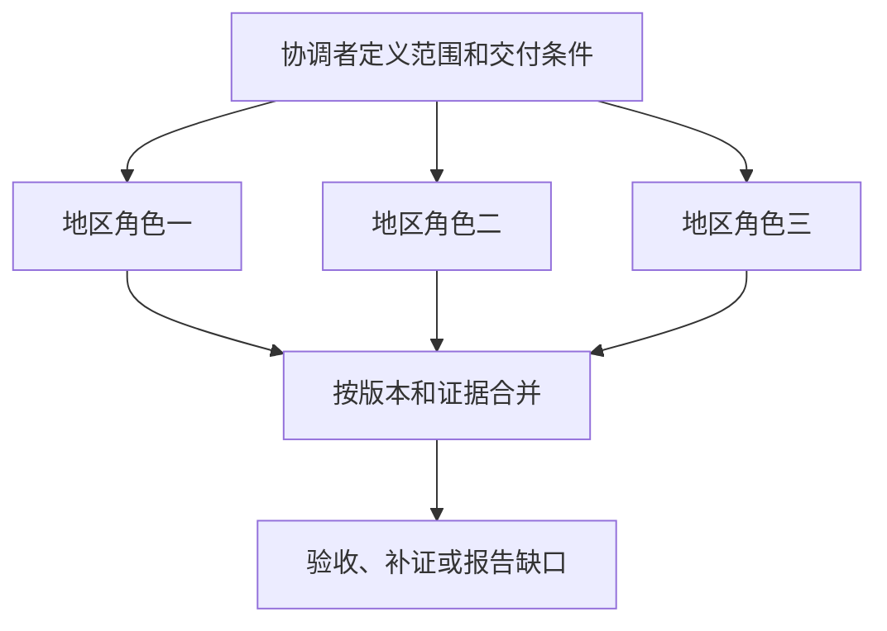

## 从并行工具开始判断是否需要分角色

部门要比较三个地区的差旅政策。若搜索只是按地区键查固定表，单 Agent 或代码可并行调用三个读工具。若每个地区有不同资料来源、独立访问权限和不同的验证步骤，三条任务流可以分配给各自的角色。Supervisor 定义共同的比较口径，地区 Agent 独立取证，汇总角色验证冲突和证据覆盖。分角色的收益来自可分任务和局部自治，代价来自沟通、聚合和更难定位的错误。

## 一份可以领取也可以验收的任务

委派记录至少包含任务 ID、上游运行 ID、任务版本、地区与生效日期、可用证据源、完成条件、截止时间和返回契约。返回记录包括状态、证据 ID、来源版本和待补条件。例如华南 Agent 返回「适用华南区域、支付日在 2026 年 11 月，来源 CN-S-07 第 4 条。北京属于另一路任务」。汇总一次任务时，用已核对的来源和版本取代自由转述。对于拒绝和缺证，保留结构化状态。

只有协调者写任务级进度，各地区只写自己的产物空间。汇总时按任务版本去重。如果地区二重试且旧结果晚到，只有当前允许版本的结果进入本次汇总。对于统一的比较口径，可以给角色读相同快照。权限较窄的成员只看到必要输入，跨域汇总时仍检查最终读者可见性。

## 三类协作关系解决不同问题

| 方式 | 控制权和通信 | 主要代价 |
| --- | --- | --- |
| Supervisor | 一处接收请求、按能力委派和验收 | 协调者负载和决策偏差决定全局 |
| 分层 | 上层以地区或产品线划分，下层主持局部任务 | 多层汇总增加延迟，对版本和职责要求更高 |
| 对等协作 | 成员之间直接协商，有共享协议或事件流 | 需要冲突、消息去重和结束规则 |
| Debate | 独立形成候选后相互核查，交给裁决者或检查器 | 多轮模型成本高，证据相关性仍来自真实来源 |

如三路任务分别耗时 2、3、5 秒，拆分和汇总各 1 秒，在无排队和重试的理想情况下并行阶段按最长分支计，总计 7 秒，顺序完成总计 12 秒。若额外安排一轮全互评，或所有角色争抢同一个限流服务，收益可能消失。用同样数据对比单 Agent、单 Agent 并行工具和多 Agent 三个基线，分别记录覆盖、证据冲突、尾部时延、调用成本和失败后能否恢复。

## 小结

多 Agent 适合权限、能力或探索路径有真实边界的任务。把委派、状态所有权和验收写进消息契约，再比较并行收益与协调成本。

## 参考资料

- [Anthropic：Building effective agents](https://www.anthropic.com/research/building-effective-agents)
- [Wu 等：AutoGen](https://arxiv.org/abs/2308.08155)
