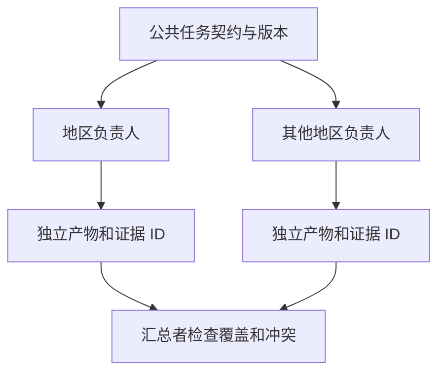

## 同一份合规报告可以让不同节点负责完成

企业需要六个地区共同完成采购合规清单。每个地区的资料只对相应身份可见。最后要统一比较制度生效时间、采购类型和例外，并允许个别地区暂时无结果。设计拓扑前先确认谁能分配任务、谁拥有地区产物，以及谁能代表整个系统签收结果。

| 拓扑 | 消息怎样走 | 谁拥有当前状态 | 主要压力 |
| --- | --- | --- | --- |
| 集中式 / Supervisor | 所有委派与结果经过中心 | 中心管理任务级状态，各分支写产物 | 中心吞吐、扇入等待和单点影响 |
| 分层式 | 总协调者对区域负责人，负责人对工作者 | 每层只管理自己的子树和上行契约 | 过期预算、重复汇总与故障归因 |
| 去中心化 / 对等 | 节点可按契约互相协商移交 | 任务拥有者或共享协议决定迁移 | 重复占用、死锁、版本及消息风暴 |
| 网络式组合 | 走语义或能力匹配的有限邻接关系 | 所有权随协议显式转移 | 需要路由收敛、超时与显式终止 |

共享 Context 可以叠加在这些拓扑上。例如各地区读同一比较标准的版本 v4。主管只汇总分区内出具的证据摘要和引用，具备权限的人工才可读底层文档。相同 Context 的语义应由任务版本和引用表达。共享状态服务生产并发语义，消息系统负责交付及关联，二者可以分别替换。

### 在扩大节点数前算清通信和恢复

假设每个工作者一条委派加一条回执，六个工作者经中心共需要 12 条工作消息。若每个结点都主动向其他五个结点推送一次，则有 30 条有向消息。这个比较只描述理想单轮计数，重试、事件广播和聚合可能占用更多。以同一任务产生的实际 Trace 来定位瓶颈，尤其注意中心排队与共享服务限流。

故障演练可以让第四地区在重启后重复提交、第五地区的旧版本结果晚到、第六地区永久缺证。用任务版本和工作项 ID 去重。保存不可变的分支产物，允许汇总按预设规则交付部分结果。若旧结果时间跨过政策变化，不进入本次验收。对等拓扑还要定义失联后的重新领取由谁判定，以及同一任务有两份上报时谁决定有效性。

## 小结

拓扑选择取决于沟通规模、权限分区、失败隔离及任务终态的责任。先建立统一的任务契约和证据回执，再比较集中、分层与对等的实际代价。

## 参考资料

- [Wu 等：AutoGen](https://arxiv.org/abs/2308.08155)
- [Anthropic：Building effective agents](https://www.anthropic.com/research/building-effective-agents)
