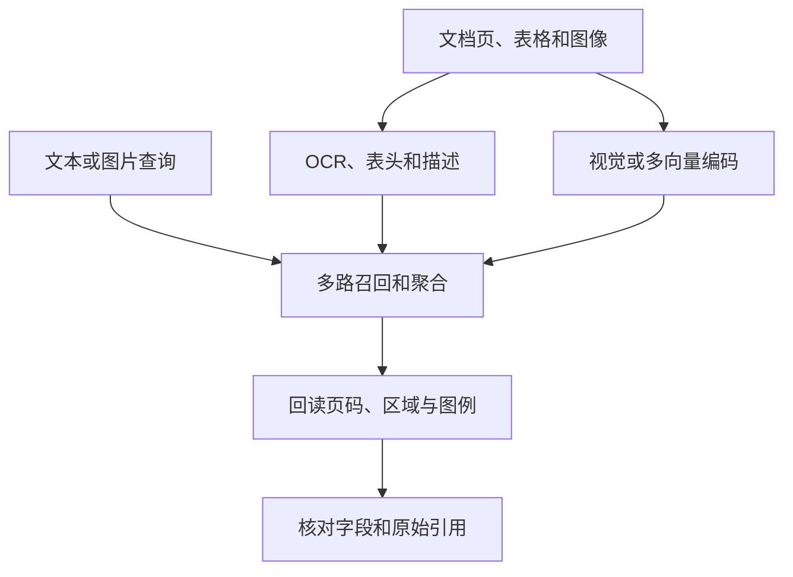

## 查询需要读图，文本层却只有图题

一份设备手册写着「参见图 4」，实际兼容条件只在图例与连线标签中。另一个概览页面写「红色虚线表示预估」，真正的季度数值要看附表。在这种资料中，PDF 文本层、OCR 文本和图像都有作用。只索引文本会错过视觉结构，直接把截图交给模型又可能把颜色、量纲或表格单元格读错。

多模态 RAG 允许索引和检索多种证据表示，再把适合的原始内容交给生成或结构化提取。输入查询可以是文字或图片，返回可以是页、图、表甚至裁出的区块。关键设计要覆盖两件事：是否能定位正确视觉区域，是否能把结论准确归因到该区域。

## 三种索引方式怎样选择

| 方式 | 怎样检索 | 主要取舍 |
| --- | --- | --- |
| OCR、表格提取与图像描述 | 索引文字、表格行、图题或模型描述 | 复用文本检索，无法完整表达布局和视觉关系 |
| 视觉与图文向量 | 将文字查询和页图或图像块放到可检索的相似度空间 | 能找布局和视觉内容，细节、数字和图例仍需核验 |
| 多向量晚交互 | 用查询 Token 与图片局部表示的细粒度匹配打分 | 可找局部对应，索引、存储和评分成本更高 |

以 ColPali 为例，它用视觉语言模型将文档页面转成多向量表示，并借助晚交互机制做检索。一个典型晚交互思路是对每个查询 Token 取与页面局部向量的最高匹配分，再对查询侧聚合。页面命中表示其中可能存在要找的信息，精确引用仍可能需要进一步找区块。OCR 与视觉路都命中同页时，可以按页或区块的稳定 ID 归并。

## 从页命中到字段核查

第一阶段优先找到相关页，同时用型号或引用号精确匹配。第二阶段针对预算选择整页、区域或邻段。整页保存图例、标题与主体关系，小裁剪提高局部分辨率但也容易切掉单位或图例。让多模态模型输出结构化结果时，保存源文档 ID、版本、页码、矩形区域和图表标识。表格数值保留行名、列名、单位、空值和合并单元含义。只有曲线像素时注明近似，能查到原始数据表则优先使用原值。对未知颜色、模糊数字和跨页表头，应表示缺证或请求人工核对。

图片可能包含条码、扫描指令或敏感内容。按与原文一致的身份和范围过滤其表示和裁剪缓存，将图片中的文字作为资料处理。任何视觉线索都不能修改系统权限或扩大证据范围。输出应让读者能从引用跳到原页，核对同一张图是否真支持声明。

## 同一页命中可以产生三种不同结果

假设一页有左上角的兼容示意图、右侧的温度曲线、下方的参数表。问题一问「B 设备连到哪个控制器」，问题二问「实测曲线峰值大概何时出现」，问题三问「标称温度上限及单位」。三题正确页相同，正确区块却分别是示意图节点、曲线与图例、参数表行和列。只验收页 Recall@1 会把三个定位结果都视作成功。

在标注中使三题各有独立区块与字段契约。对于示意图核对连接端点，曲线核对实测与预测图例以及允许的时间误差，参数表核对行、列和值的单位。若系统引用正确页但在第二题读取了预测线，应记为区域或语义验收失败。若原图分辨率不足，输出明确近似范围或说明证据不够细。该分层可以直接判断投入应落在页检索、分辨率还是生成检查。

## 怎样评估和长期维护

按文本清晰、纯扫描、复杂表格、图片、图例和弱分辨率分层。检索以页和区块两级计算召回，答案单独测字段、单位、数值或空间关系。对照「OCR+BM25」「文本和视觉混合」「视觉命中后局部复核」。状态应保存解析和编码版本，且测试不同页面缩放、文档布局更新、图片替换和权限撤销。多模态方案带来的提升应能落在一类明确任务上。

## 小结

文本代理便宜可解释，视觉索引捕获布局和图像，多向量匹配更加细粒度。可靠系统还需要保留源区域，并对读取出的字段与解释条件做验收。

## 参考资料

- [Faysse 等：ColPali，文档页面视觉检索](https://arxiv.org/abs/2407.01449)
- [Khattab 与 Zaharia：ColBERT，晚交互检索](https://arxiv.org/abs/2004.12832)
