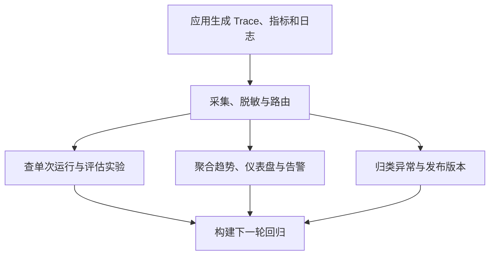

## 工具选择先从一个排查任务出发

上线新索引后，政策问答总完成率正常，但地区例外漏证变多。值班要知道影响范围，开发要定位召回或生成步骤，评估者要在固定样本上复跑版本差异。这些工作共享事件与版本标识，使用的视图不同。

| 工具 | 常见职责 | 应放进验证的问题 |
| --- | --- | --- |
| OpenTelemetry | 采集与导出跨服务遥测 | Trace 是否跨 Worker 关联，字段能否控制 |
| LangSmith | 追踪、数据集、实验和评价 | 是否可复跑同一任务并比较候选版本 |
| Langfuse | 模型调用观察、用量、数据集和评价 | 是否能关联模型/工具成本与业务任务 |
| Arize Phoenix | 基于遥测的追踪和模型应用评价 | 如何查检索候选及与输出的关系 |
| Prometheus | 指标时间序列、查询和规则 | 直方图维度、失败率、采集覆盖 |
| Grafana | 仪表盘及告警等工作台 | 能否从聚合态跳转事故诊断视图 |
| Sentry | 异常归类和发布关联 | 重复异常是否合并，能否定位变更版本 |

## 用同一个故障对照选型

固定十条地区政策问题，对新旧索引在同一环境运行。先查看召回和实际上下文。若候选已包含例外但最终引用缺失，将该条 Trace 转为脱敏回归样本，用独立断言检查「例外证据实际进入上下文」。仪表盘显示同类问题的影响范围，错误记录解释服务是否曾超时。可把测试结果和线上指标按同一工作流版本关联。

## 确认部署、数据与成本边界

先实测导出、保留、采样、权限、私有部署和删除的具体能力。不同组件可能为同一请求重复插桩，确认运行标识与计数，避免费用被计算两次。用一份模拟事故演习验证从告警到回执和回归的完整路径。产品方案变更时保留有版本的数据集、量规与业务回执，减少工具迁移的耦合。

## 小结

统一运行标识和评价任务，按采集、诊断、回归与报警选择组件。以可复查的实际失败衡量工具是否解决问题。

## 参考资料

- [LangSmith：Evaluation](https://docs.langchain.com/langsmith/evaluation)
- [Langfuse：Observability](https://langfuse.com/docs/observability/overview)
- [Arize Phoenix：官方文档](https://arize.com/docs/phoenix)
- [OpenTelemetry：Signals](https://opentelemetry.io/docs/concepts/signals/)
- [Prometheus：Histograms](https://prometheus.io/docs/practices/histograms/)
- [Grafana：Dashboards](https://grafana.com/docs/grafana/latest/dashboards/)
- [Sentry：Issues](https://docs.sentry.io/product/issues/)
