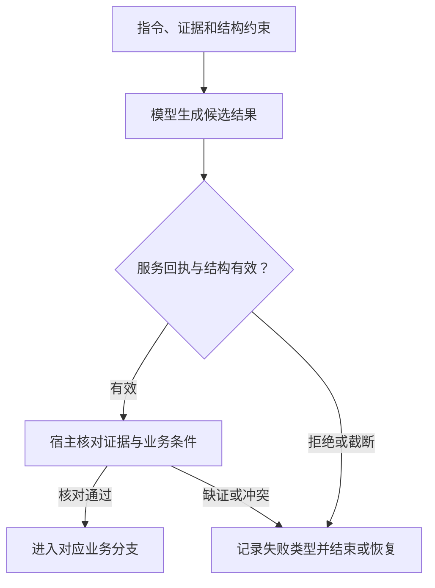

## 审批草稿有三个不同的成功条件

人事助手需要给出一个动作建议，告诉流程系统是继续提交草稿、索要资料，还是转人工。模型回答「看起来可以报销」对读者有意义，流程系统却无法确定下一状态。最直接的改法是要求 JSON。输出 `{"decision":"approved"}` 能解析，但系统要的是 `draft_ready`，而且批准本身属于人工审批。可用契约同时定义**数据形状、业务状态和状态的验证人**。

在这个案例中，宿主已把现行条款限定在用户可见范围，并把检索结果以来源 ID 提供给模型。模型生成建议和引用。宿主对引用、条件和工作流状态做校验。任何真正的提交仍调用单独的授权工具。

## 明确每个字段在消费者眼里的含义

下例把待补资料表示为 `missing_info`，让每个分支返回相同字段集合。空数组代表没有附带来源。该例使用 JSON Schema 对象属性与必填字段，业务约束留给宿主。

```json
{
  "type": "object",
  "properties": {
    "decision": {
      "type": "string",
      "enum": ["draft_ready", "missing_info", "manual_review"]
    },
    "source_ids": {
      "type": "array",
      "items": {"type": "string"}
    },
    "reason": {"type": "string"}
  },
  "required": ["decision", "source_ids", "reason"],
  "additionalProperties": false
}
```

JSON Schema 全规范支持多种组合和条件。模型 API 通常只支持某些子集，提交前按实际服务核对。上例统一字段集合，有利于多个消费者接入。若某字段必须区分「合同明确没有上限」与「无法确认上限」，应用显式状态表达两种结果，避免用一个空字符串承载两种意义。跨字段规则也应写清楚，例如 `draft_ready` 至少有一个可访问来源，`missing_info` 要指出哪个业务条件缺失。

## 从模型输出到状态迁移



只用 Prompt 约定格式时，模型仍可能加 Markdown 围栏或漏字段。JSON 模式主要约束语法。支持结构化输出的服务可以在解码时依据 Schema 限制候选后缀。拒答、中断和输出长度上限仍需按服务回执处理。宿主先区分回执，再解析并验证结构，最后核对语义。

例如用户问「会议延期的改签费能否报销」，模型给出 `draft_ready` 和 `P-17`。虽然枚举正确，应用查到 P-17 已失效。若本次还有现行条款，宿主可要求按这些证据重新组织一次。若可见资料不存在，结果进入待补信息。两种情况都应保留失败阶段，评估时才能区分「格式不合规」和「证据不足」。

## 让契约可演进

一份契约至少有模型输入、宿主校验和消费者三个位置。变更枚举、字段或空值语义时，维护可追踪的契约版本。通过旧结果回放、拒绝和截断样例验证消费者，再逐步切换生产者。日志记录解析失败、Schema 失败和业务失败各自数量，排查时可以直接定位改动属于哪一层。工具调用同样会使用参数 Schema，但会额外经过身份、授权与动作审计。

## 小结

结构约束降低机器消费的歧义。引用是否真实、数据是否可见、业务状态能否变更，由拥有这些事实的宿主或业务服务验证。为缺证和人工分支设计明确的输出，对整个 Agent 的可靠性有直接影响。

## 参考资料

- [JSON Schema 官方文档：Objects](https://json-schema.org/understanding-json-schema/reference/object)
- [OpenAI API：Structured Outputs](https://developers.openai.com/api/docs/guides/structured-outputs)
