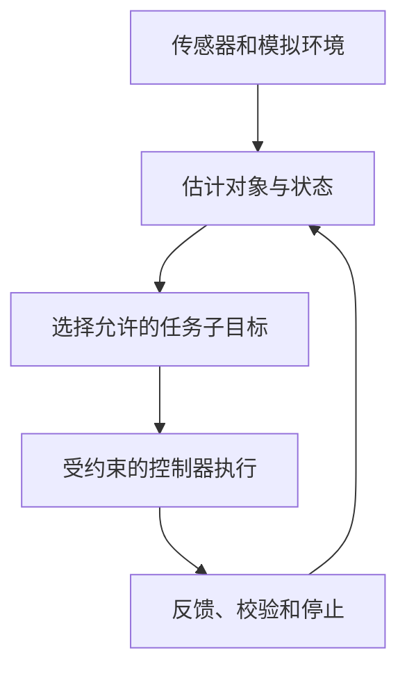

## 从观察到实际动作跨了多层

在一个模拟环境中，把标记为蓝色的盒子移动到空置货位。视觉感知估计物体和货位状态。高层任务模型选择目标与顺序。控制器根据局部状态执行短时动作并返回反馈。系统核对盒子是否实际到位。语言计划和感知均有不确定性，任何影响物理安全的约束应由相应的验证与控制组件实施。

## 仿真与真实环境之间有什么差异

仿真适合用可重复条件记录行为，例如挡住部分标记、改变位置、让货位不再可用。真实环境还会出现光照、时间同步与执行误差。验证应按任务和条件报告，模拟结果与真实结果分别记录。物理部署需要受控区域、相应安全系统与专业评估，不从模型演示跳过校验。

## 前沿证据怎样阅读

视觉语言动作模型的研究展示了部分语义任务迁移能力。训练场景、动作空间、机器人形态和任务定义限制证据范围。比较方法时检查固定基准、实际验证条件、异常与人类接管信息。家中开放环境与受控台面的成功率不能直接互换。

## 小结

具身系统把感知、任务决策、连续控制和反馈连接起来。仿真用于可重复研究，真实场景需要单独验证。

## 参考资料

- [OpenVLA：An Open-Source Vision-Language-Action Model](https://openvla.github.io/)
- [Google DeepMind：RT-2](https://deepmind.google/discover/blog/rt-2-new-model-translates-vision-and-language-into-action/)
