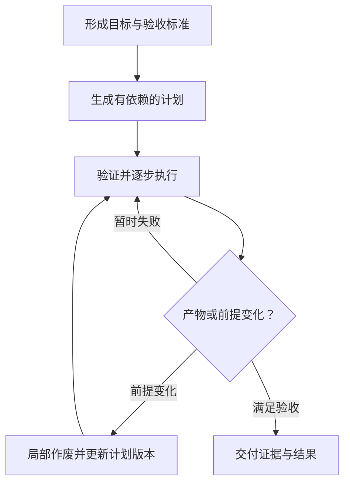

## 比价任务为什么需要有形的计划

采购同事要比较 A、B、C 三家报价，统一货币和税费，说明差异并生成可审查的清单。即使三个报价可并行读取，归一化也必须看到三家资料的版本和日期。Plan-and-Execute 将这些依赖写入计划，执行器按计划领取和验收工作。随环境变化可以更新计划。

### Planner 应交给执行器什么

计划包含目标、已确认假设、步骤依赖、工作预算，以及每步可检查的输出。例如节点 `normalize` 依赖 `quote:A`、`quote:B`、`quote:C` 和 `fx:v1`。结果必须含报价版本、金额、币种、税率适用时间和依据。执行器先验证节点设定是否引用允许的工具、依赖是否存在、是否有闭环和越权动作。工具获取真实报价后，按工作项记录可验证产物。

三份报价已取回时，C 发来修订版。只让 C 重取，并使归一化后的总表及审查失效。A 和 B 在确认现行性后可保留。若汇率也必须按新时点重新计算，则生成 `fx:v2` 后重跑所有依赖汇率的归一化结果。迟到的旧 C 通过计划版本识别并隔离，不应覆盖新结果。

### 和直接循环、固定 Workflow 怎样组合

当步骤少且下一步高度取决于即时观察，ReAct 的寻路成本较低。固定 Workflow 适合重复业务规则，强调明确状态与审批。Plan-and-Execute 适合任务要拆出多个有独立产物的分支，并需动态更新依赖图。可以固定「验收计划、核对权限、提交」三个外部边界，在其中按计划调度取证节点。每步最长等待和任务全局预算都需要留下记录，禁止计划重算不断延长预算。

## 小结

计划是对目标、输入、输出、依赖及失败路径的声明。执行器验证与记录真实结果。重规划从受影响的前提出发，复用仍适用的产物。

## 参考资料

- [Wang 等：Plan-and-Solve Prompting](https://arxiv.org/abs/2305.04091)
- [Anthropic：Building effective agents](https://www.anthropic.com/research/building-effective-agents)
