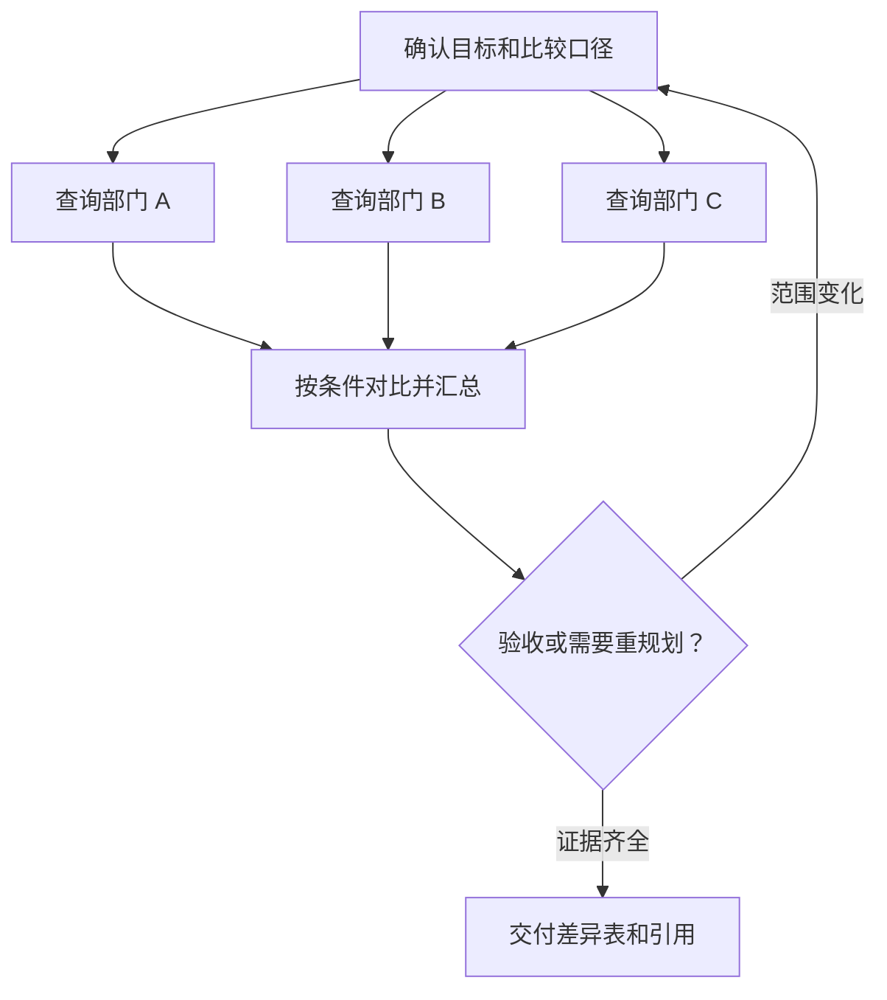

## 任务变长后，每一步都临场决定有什么问题

审计同事要对比三个部门的最新资产政策，生成可核查的差异表。一般要先确定制度版本和部门范围，再并行查不同政策，最后核对口径并汇总。如果 Agent 每轮只看当前工具结果，可能不断补查某部门，却忘了跨部门需要在同一日期和金额单位下比较。规划把目标、预期制品、依赖关系和退出条件显式化。

## 从任务拆解到依赖图

先识别最终验收：三部门现行政策可访问、有版本来源、每条差异标明范围、冲突或缺证可解释。然后拆成产出可以独立验证的任务。比如「确认部门和日期」「收集每部门证据」「归一化单位和条件」「对照差异」「审查引用」。描述每步所需输入、交付物、责任、预算和失败动作。若 A 的结果是 B 的必要输入，在依赖图中用 A → B 表达。没有依赖的多个读取任务可并行，合并前必须核对它们是否属于同一口径。

依赖图为有向无环图时，可拓扑排序决定先后。达到读取条件的任务可按关键路径、资源或业务优先级调度。让很慢的外部查询尽早启动可能减少总耗时，但要先确认它不依赖未验证的范围。如果有循环修订，需要将循环封装在一个有独立停止条件的任务内，不能把「验证依赖修改、修改依赖验证」作为无出口依赖。

## 静态计划什么时候被新证据推翻

静态计划适合可预测的任务阶段。动态规划需要在条件变化时重排。假如第三个部门合并进另一个部门，已收集的原部门政策适用性需要重新确认。重规划应记录触发观测、作废步骤和保留制品。保留仍然有效的证据，重跑依赖变更边界之后的阶段。默认重新生成整个计划会浪费成本，还可能重复已执行的外部动作。并发时让计划版本和任务结果绑定，避免旧步骤执行到一个已变更的目标上。

Agent 可以在一个相对固定计划节点内用 ReAct 进行有限探索，例如按当前结果寻找地区例外。规划解决跨步骤的全局组织；局部推理根据观察查证，执行器进行权限检查和工具调用。若可能执行有副作用动作，计划本身不能授权写入。对缺证、超时和审批失败规定清晰的异步等待和有界结束。

## 演算一次排程和局部作废

假设范围确认用 1 分钟，收集政策 A/B/C 分别用 2、5、3 分钟，比较需 2 分钟，最终核查需 1 分钟。人工与工具资源充足、采集可并行时，关键路径穿过 B，总耗时 1 + 5 + 2 + 1 = 9 分钟。若 A 与 C 共享只能一次访问的资源，串行耗时恰为 5 分钟。若 B 与 C 共享，关键路径变为 1 + 8 + 2 + 1 = 12 分钟。任务依赖与资源互斥需要分别建模。

| 工作节点 | 版本 1 状态 | B 的政策生效期变更后 |
| --- | --- | --- |
| 比较范围 | 已确认 | 地区范围不变，继续使用 |
| 证据 A / C | 已核实，附版本 | 核对日期仍适用后保留 |
| 证据 B | 只找到过期政策 B-1 | 只重启 B 的取证，已过期材料标为历史证据 |
| 差异表与最终核查 | 曾基于 B-1 生成 | 随依赖作废，等 B 新回执后重跑 |

执行器看到版本 2 后，不再以迟到的版本 1 回执推进差异表。若直到截止时间仍没有 B 的现行证据，交付 A/C 的可核对比较和明确的 B 缺口，按预设的部分成功规则结束。只有当资料版本变化足以推翻比较范围时，才回到第一步。推理怎样择优验证局部候选，见[Agent 推理](/agent-engineering/capabilities/reasoning-and-search/)。

## 小结

好的计划让任务与验收可检查。将依赖、可并行工作、优先级和预算写入计划，在出现明确观测变化时重规划，并保持已经验证的产出。

## 参考资料

- [Wang 等：Plan-and-Solve Prompting](https://arxiv.org/abs/2305.04091)
- [Yao 等：ReAct](https://arxiv.org/abs/2210.03629)
