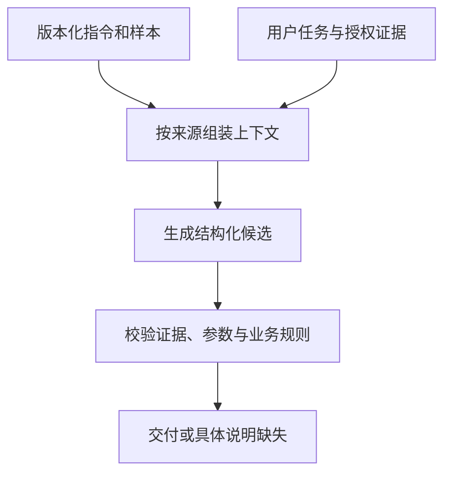

## 同一模型为什么对两种问法得出不同答案

让模型处理政策问句。只写「请回答员工问题」，模型可能给通用建议。补充角色、任务目标、输入证据和输出格式后，它才更有机会写出适用主体、条件和出处。提示设计从任务说明出发，告诉模型读什么、怎样决定输出、遇到缺证怎样处理。可信规则、用户问题与外部资料要以定义清晰的边界传递，避免把有效证据和应用指令混在一个字段里。

## 系统指令、用户目标与资料各有来源

System 或开发者消息在实际 API 中按其消息层级承担应用规则，使用的角色和优先级以平台文档为准。User 消息说明本次目标、语言、范围和偏好。工具回执和文档属于数据，应以结构字段或明确界限传给模型。读取的原文中可能有「请忽略前文」等自然文本。把来源分隔能提高界限可辨性，更重要的是程序永远用已授权身份和策略决定权限，提示本身不能执行认证或安全隔离。

角色提示可指定读者、术语和文体，例如「面向第一次报销的员工写解释」。角色没有增加知识权限或专业资质，也不能让其凭角色编造政策。对需要算金额或查询账户的任务，让确定性组件完成事实计算和授权。

## Zero-shot、Few-shot 与可核对推理

Zero-shot 直接描述任务与验收，虽然简单，仍可以清楚规定「证据不足时说明缺什么」。Few-shot 给一组代表性输入输出，帮助模型识别分类和结构。例如同时提供通用规则、带例外和两份冲突文档的案例，避免模型只从一个成功例学会强行回答。示例包含可区分问题的信号，跨度过大或错误示例会带来偏差。长度有限时按任务类型选择最相关的少量示例。

推理型提示可请模型先列待核关系、再引用证据并给出结论，例如先核对人群、日期和费用类别。对用户和日志保留必要的理由摘要、输入来源和可重复的验证步骤即可。不要把冗长自然语言思考当作真实性证明。多条中间结论应各自有事实依据。

## 从手工提示方式过渡到版本模板

把稳定的任务意图、输出标准与业务限制写入模板，把本次变量放进具有类型和来源的字段。保存模板版本、模型配置、工具和上下文构造方法。先做一个可解释的基线，再一次只改动示例、证据顺序或输出格式的一部分。评估覆盖正常任务、缺字段、歧义、过期资料和不可信文本，记录正确性、引用、合规和 Token 成本。失败定位时先看必要数据是否提供。错误来自检索缺证时，反复改措辞不会找到政策。

输出结构与提示可以组合。Schema 约束表示形状，业务校验检查具体值。对于会写业务数据的应用，模型产生结构化候选后仍需检测参数、范围与授权。

## 用对照样本定位是哪一层改动生效

以报销问答为例，先固定模型版本、检索结果和用户身份。从同一组输入比较三次实验，每次只改一个变量。第一次只调整系统指令，让缺证分支先明确事实缺口。第二次在原指令上加入一个条件相似但结论不同的 few-shot 例子，让模型学到「付款日与申请日不能互换」。第三次保持 Prompt 不动，改 Context Assembly，让现行政策和例外一起进入窗口。分别记录任务成功、条款引用可核对率、错误拒绝率、Token 成本。若第三次才提升，引导改动应落在证据选择，继续添加提示语收益有限。

长期记忆、上下文和提示属于不同寿命的数据。用户确认的默认城市可从 Memory 召回。当前问题、该城市及检索到的版本化政策构成本次上下文。Prompt 则说明在缺地点时如何处理默认值、答案应怎样附出处。把外部资料放在标记为数据的独立字段，所有工具权限在宿主处校验。正文被提供给模型只获得参与回答的资格，不能改变运行时授权。输出契约和约束解码见[结构化输出](/agent-engineering/capabilities/output-contracts/)。

## 小结

提示由可信指令、任务、示例和证据组成。用版本与固定样本检验效果，并把输出约束、事实验证与执行权限留给适合的机制。

## 参考资料

- [Brown 等：Language Models are Few-Shot Learners](https://arxiv.org/abs/2005.14165)
- [OpenAI 官方指南：Prompt engineering](https://developers.openai.com/api/docs/guides/prompt-engineering)
