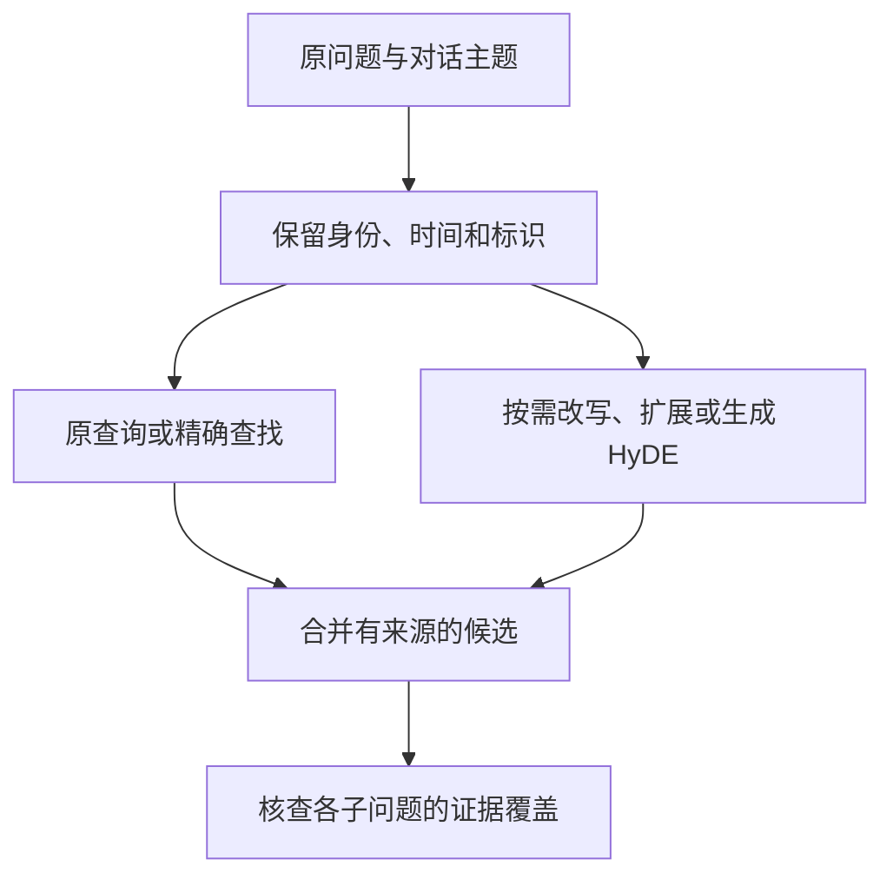

## 改写要解决检索表达差异

用户先问某类设备，追问「去年那批也一样吗？」直接给检索器后一句，没法分辨设备、政策或「去年」的时间范围。查询改写先把指代和省略补足，再转换为更容易命中知识库的表达。原问题应始终保留，用于理解最终任务和对照改写是否改变意图。可信业务约束例如身份、版本日期和权限，由服务端保存为独立字段。

## 四类方法输入和输出有什么不同

| 方法 | 输出 | 适用与注意 |
| --- | --- | --- |
| Query Rewrite | 一条更完整或更适合检索的问句 | 消解指代、改写口语。容易凭空补一个主体 |
| Query Expansion | 原问题外增加术语、同义词或别名 | 适用于已掌握词表和缩写，过多词会引入噪声 |
| Multi-Query | 并行生成几种表达或可单独回答的子问题 | 扩大召回覆盖。需要合并去重，也要区分改述和分解 |
| HyDE | 生成一份假设性答案文档，再用该文本做向量查询 | 缩小查询和待检索文风的差异。生成的内容只用于搜索 |

Multi-Query 里，改述是同一需求的多种表达。分解则把「什么情况复核，谁复核」拆成两个需要分别找足证据的目标。如果每支候选都以 RRF 合在一起，重复改述可能把同一证据垄断前排，分解任务应记录每个子问题的证据覆盖，再汇总。一个查询可以适合向量编码，另一个保留原始编号给 BM25。原始词法路线给改写策略提供可复用的回退。

HyDE 先生成一个看似相关的短文，把短文编码后寻找邻近的真实文档。比如「财务复核通常能在固定资产调拨条款中找到」这句也许更像手册，但生成出的阈值可能是错的。**假设文档不进入证据集**。评估 HyDE 时单独检查实际召回，并禁止以假设文本作为引用。

## 怎样防止模型把关键意思改没

对例子可明确传入历史主题「资产调拨」、当前日期与期望实体。构造「查询文本」「原样保留标识」「时间范围」「待澄清字段」这样的结构。像「不含税」「超过」「2025 年生效」都是高风险约束。优先原样保留并校验，不靠相似词替代。两种主体都合理时，应发起澄清，或以两个明确标记的查询分别检索后把歧义告知用户。改写模型不能自行增加知识权限。

成本来自生成改写、检索支数以及融合工作量。优先设门控。例如已出现准确错误码或制度条款号时先走精确路线，口语和对话追问才启动改写，召回列表证据薄弱时再发起其他分支。实验保留原始查询、所有变体、候选和权限条件。比较原始检索、仅改写和多路组合下的证据覆盖与端到端延迟，尤其检查缩写、否定、版本和新名词。

## 小结

查询改写改善查询表达，最后仍由真实文档提供证据。原始问题、不可变约束和每个查询分支的结果都应可追踪，方便识别模型在哪一步引入新的假设。

## 参考资料

- [HyDE：Precise Zero-Shot Dense Retrieval without Relevance Labels](https://arxiv.org/abs/2212.10496)
- [Query Rewriting for Retrieval-Augmented Large Language Models](https://arxiv.org/abs/2305.14283)
