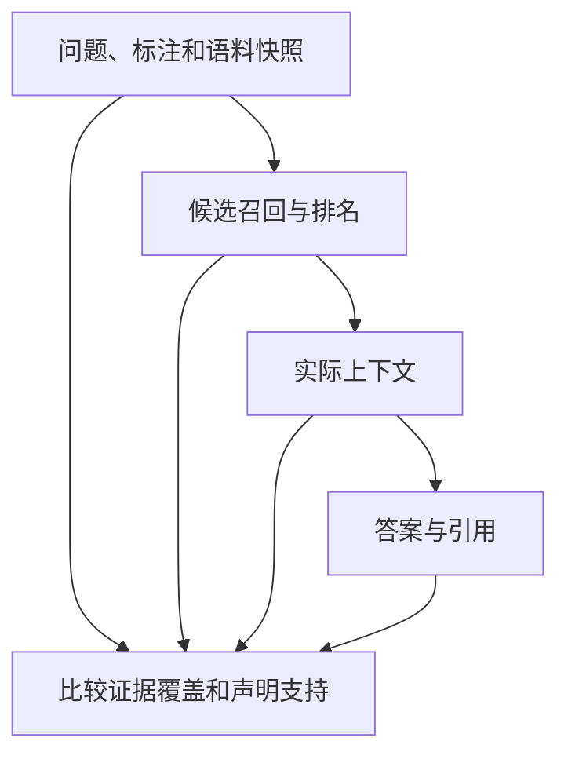

## 同一个错误答案可以来自四处

政策问答把「超过五万元需要财务复核」说成「超过三万元」。原文件也许被 OCR 读错，正确段也许没被召回，组装上下文时也许放入了旧版。即使模型读到了正确政策，也可能在输出时改错数值。评估要保存真实问题、身份、时间、允许的知识范围、人工标注的证据坐标、期望结论和应拒答或澄清的情况。输入固定数据快照，分别记录候选、重排后结果、实际上下文和答复。

## 排名层：证据有没有被找到，排得有多早

设每题有两个相关证据 A 和 B。前三名是 X、A、Y，B 在第四。Precision@3 是 1/3，分母是展示位数。Recall@3 是 1/2，分母是全部已标注的相关证据数。若范围内可判定「没有可用证据」，该题不宜把 Recall 当 0 混入证据题，应评估缺证识别和错误引用。第一条相关证据第 2，所以该题倒数排名为 1/2，带截止时没命中的样本计 0。MRR 是所有样本倒数排名的均值，用来观察首条相关证据有多早，无法反映多个必要证据有没有找齐。

nDCG 允许按证据价值分等级。每个位置 i 的增益经 log₂(i+1) 折扣，再除以理想顺序的折扣增益。可用 gain(g)=2ᵍ−1，也可以把 g 直接当增益，复现实验要写清定义。假设前三条相关等级为 0、2、1，用指数增益时 DCG 约 2.393。若该评估题的理想前三级是 2、1、0，IDCG 约 3.631，nDCG 约 0.659。若还有第四条标注等级更高，理想排名必须从完整标注集计算。

## 上下文层和答案层测什么

**Context Precision** 关注有用片段在提供给模型的上下文里的数量或排序，具体指标实现可按相关性标注或用评判器判读。**Context Recall** 衡量已传入的内容能覆盖多少参考证据或参考声明。举例说，上下文有通用规则和三段重复说明，却缺少阈值例外，覆盖不足可能和很多片段看起来相关同时出现。上下文评估要基于模型实际收到的内容，截断之前的候选不能充当证据。

**Faithfulness** 关注生成声明能否由已提供证据支持。例如模型忠实引用过期政策，可能得分高但答案仍不符合当前时间。**Answer Relevancy** 关注是否回应用户的问题，正确性、适用版本以及引用位置应另测。数字、日期、金额上下界与审批角色可直接规则核验，较开放的陈述可拆成原子声明做人工或经校准的自动判别。RAGAS 的具体指标定义会随接口或版本改变，跑实验时应记录库版本和配置。

## 怎样从分数落到修复

如果精确证据已经出现在候选而最终上下文为空，下一步检查重排、去重或预算，而非先换向量模型。若上下文完整、答案却遗漏条件，回到生成提示、证据结构或输出校验。建设评估集时按清晰问句、跨段证据、冲突版本、无权和无答案分层。记录未标注但合理的证据并补充标注，避免用指标惩罚有效替代。用人工样本校准 LLM 判别，再用同一批任务比较版本，并单列 P95 延迟、成本与关键类别错误。

## 小结

用相关证据排名检查检索，用实际上下文覆盖检查组装，用声明支持、事实正确性和答案相关性检查生成。每层都保留证据 ID 和版本，分数才能指导修改。

## 参考资料

- [ir-measures：检索排名指标定义](https://ir-measur.es/en/latest/measures.html)
- [Es 等：RAGAS](https://arxiv.org/abs/2309.15217)
- [Ragas 官方指标参考](https://docs.ragas.io/en/stable/concepts/metrics/available_metrics/)
